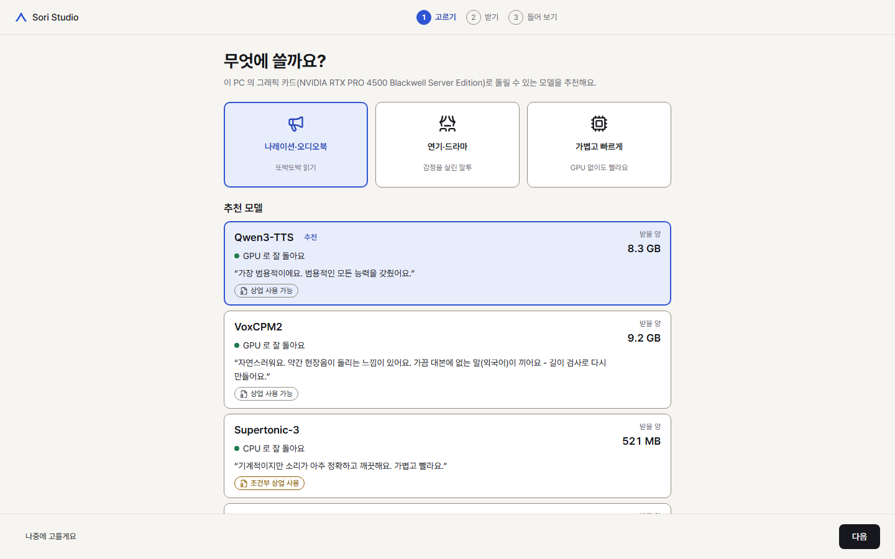
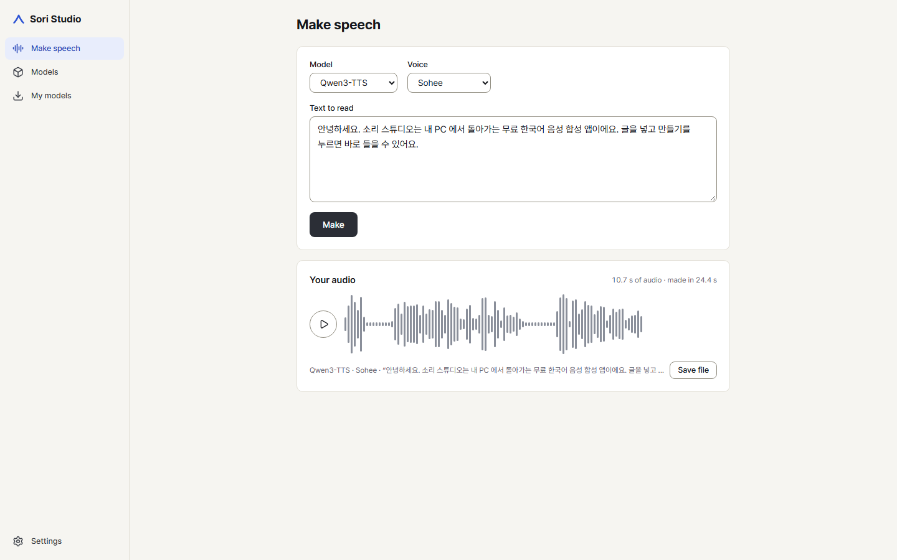

# Sori Studio

[한국어](README.md) | English

> The Korean README is the main document. This English version is a summary.

**A free Korean text-to-speech hub that runs on your own PC.** Pick open-source TTS models we tested in Korean, download them from their official sources, and run them from one simple app and one local API. Everything is free to use.

> **Preview.** The app, the desktop shell and 8 engines work, but there is no signed installer (.exe) and no script studio yet. For now, try it with "Run the development version" below.

- No account, no keys, no subscription. No telemetry.
- Model weights are not included in this repository or the app. They are downloaded from their **official source** (Hugging Face and others) when you choose them, after you see a summary and the full text of their license.
- Each engine runs in its own Python environment (uv). Packages are pinned by hash, and the app restarts an engine if it crashes.
- Engines that only run on Linux are connected on Windows through **WSL2**. If WSL2 is missing, the app detects it and guides you through turning it on.
- An optional local API compatible with OpenAI `/v1/audio/speech`, on `127.0.0.1` with a key (off by default).
- The app is available in Korean and English (Settings > General > Language; defaults to your OS language).

## Screens

| Choose | Make speech (English UI) |
|---|---|
|  |  |

A 1-minute video from first launch to hearing speech: [docs/images/demo.mp4](docs/images/demo.mp4) - recorded on a clean Windows PC downloading Supertonic-3 (521 MB); the 19-second download is sped up. The Korean narration was also made with this app (Qwen3-TTS, voice Sohee).

## Engines

Only models that run on a **32 GB GPU (RTX 5090 / RTX PRO 4500 class)** are listed. Each engine's license is separate from the app's license.

| Engine | Device | Windows | License | Checked |
|---|---|---|---|---|
| Supertonic-3 | CPU | Native | BigScience Open RAIL-M (use restrictions) | Install + audio on Windows and WSL2 |
| Kitten TTS 2 mini | CPU | Native | Apache-2.0 | Install + audio on Windows |
| Qwen3-TTS 1.7B | GPU (CPU works, slowly) | Native | Apache-2.0 | Install + audio on Windows GPU |
| VoxCPM2 | GPU (CPU works, slowly) | Native | Apache-2.0 | Install + audio on Windows GPU |
| Confucius4-TTS | NVIDIA GPU | WSL2 | Apache-2.0 | Install + audio on Linux GPU |
| CosyVoice3 0.5B | NVIDIA GPU | WSL2 | Apache-2.0 | Install + audio on Linux GPU |
| dots.tts | NVIDIA GPU | WSL2 | Apache-2.0 | Install + audio on Linux GPU |
| ZONOS3-Mini | NVIDIA GPU | WSL2 | Apache-2.0 | Install + self-test on Linux GPU |

- "Checked" means we ran it end to end, from install to audio, on clean cloud machines (Windows Server 2025 + RTX PRO 4500 32 GB, Ubuntu + the same GPU, and Windows with nested virtualization).
- **GPU engines inside WSL2 have not yet been checked on a real Windows GPU PC.** They use the same install path that works on Linux. A Windows NVIDIA driver 580 or later is needed for the GPU.
- The app checks your PC (GPU, memory, disk, driver) and tells you for each engine whether it runs well, slowly, with tight memory, not at all, or hasn't been checked on your hardware yet.

| PC (Windows) | Engines you can use right away |
|---|---|
| No GPU | Supertonic-3, Kitten (fast); Qwen3-TTS, VoxCPM2 (slow on CPU) |
| NVIDIA 8 GB | The above + Qwen3-TTS on GPU |
| NVIDIA 12-24 GB | The above + VoxCPM2 on GPU. WSL2 engines show "Not checked yet" (only checked on 32 GB) |
| NVIDIA 32 GB | All 8 |

## Run the development version

You need Windows 10/11 x64 or Linux x64 (macOS not checked yet), [uv](https://docs.astral.sh/uv/) and Node.js 22 LTS.

```bash
cd ui && npm install && npm run build      # UI -> ui/dist (served by the hub)
cd ../hub && uv sync
cd ../shell && npm install && npm start    # starts the hub and opens the window
```

In a browser instead (web app):
```bash
cd hub
uv run python -m sori_hub doctor           # this PC and a verdict per engine
uv run python -m sori_hub serve            # http://127.0.0.1:5150 - asks for the connection key the first time
uv run pytest                              # hub tests
```
The connection key is in the `hub-token` file in the app folder (Windows `%LOCALAPPDATA%\SoriStudio\hub-token`, elsewhere `~/.sori-studio/hub-token`). The desktop app fills it in for you.

Local API (turn it on and copy the key in Settings > Use from other apps (API)):
```bash
curl -X POST http://127.0.0.1:5150/v1/audio/speech -H "Authorization: Bearer $SORI_TOKEN" \
     -H "Content-Type: application/json" -d '{"model": "supertonic-3", "input": "안녕하세요", "voice": "F1"}' -o out.wav
```
The API can only make speech. Installing and removing models is done in the app.

## Network
The internet is used only when you press [Download]: models from Hugging Face, packages from PyPI and PyTorch, engine sources from GitHub, and for WSL2 engines the official Ubuntu image and NVIDIA's official CUDA repository. Nothing else is sent anywhere. The full list is in Settings > Internet & privacy.

## Documents (Korean)
- Feature design: [docs/sori-studio-features.md](docs/sori-studio-features.md)
- UI design: [docs/design/](docs/design/)
- Build steps: [docs/build-plan.md](docs/build-plan.md)
- Contributing and engine recipes: [CONTRIBUTING.md](CONTRIBUTING.md); reporting security issues: [SECURITY.md](SECURITY.md)

Issues and pull requests are welcome in Korean or English.

## License
The app code is [Apache-2.0](LICENSE) (Copyright 2026 세종소프트 유한회사, see [NOTICE](NOTICE)). Each engine and its model weights follow that engine's own license. When you use audio you made, follow the model's license (use restrictions, disclosing AI generation, and so on).

Made by ModuVoice.
