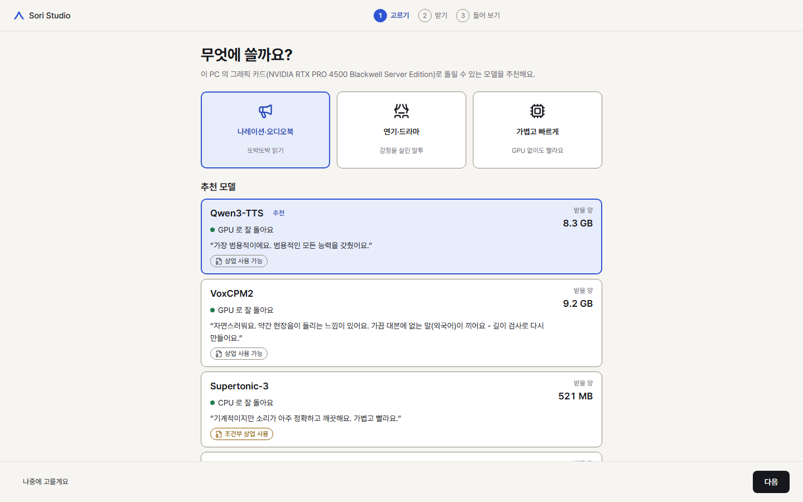
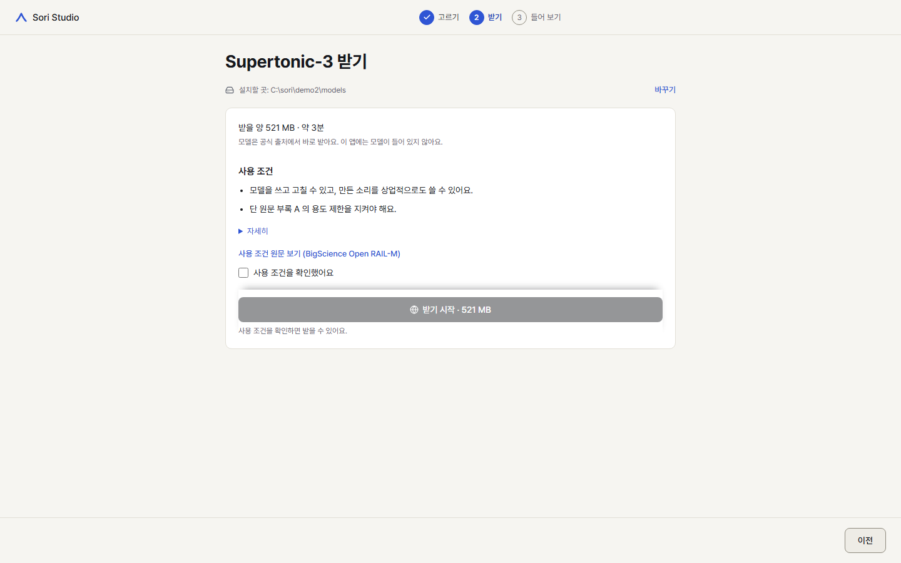
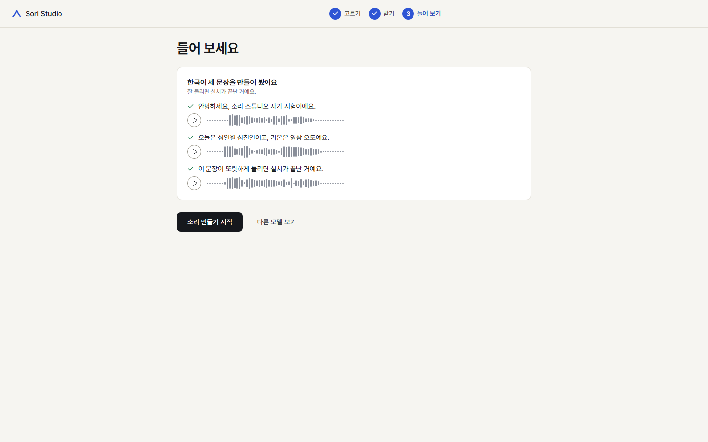
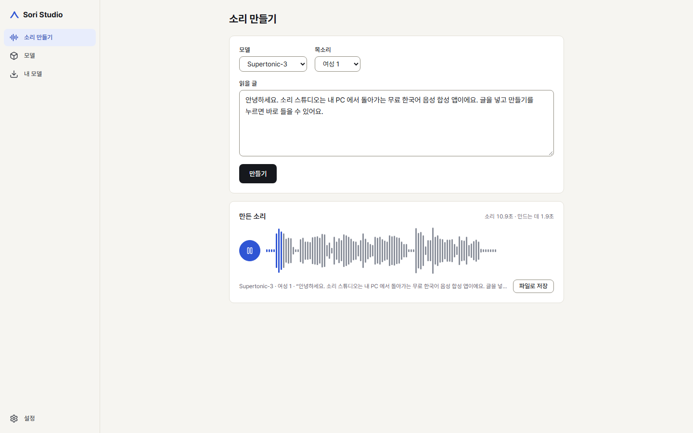

# Sori Studio(소리 스튜디오)

한국어 | [English](README.en.md)

**내 PC 에서 돌리는, 돈 들지 않는 한국어 TTS 허브예요.** 한국어로 직접 시험한 오픈소스 음성 합성(TTS) 모델을 골라 받아, 한 화면과 하나의 로컬 API 로 돌려요. 모두 무료로 쓸 수 있어요.

> **미리 보기 단계예요.** 허브·화면·데스크톱 껍데기와 엔진 8개가 돌아가지만, 설치 파일(서명된 .exe)과 대본 스튜디오는 아직 없어요. 지금은 아래 "개발판으로 켜기" 로 써 볼 수 있어요.

- 계정·키·구독이 없어요. 텔레메트리(사용 기록 보내기)도 없어요.
- 모델 가중치는 이 저장소·앱에 넣지 않아요. 고를 때 **공식 출처**(Hugging Face 등)에서 받고, 받기 전에 라이선스 요약과 원문을 보여 주고 동의를 받아요.
- 엔진마다 따로 만든 파이썬 환경(uv)에서 돌아요. 패키지는 해시로 고정해 받고, 허브가 엔진을 감시하다 죽으면 다시 켜요.
- 리눅스에서만 도는 엔진은 Windows 에서 **WSL2** 로 연결해요. WSL2 가 없으면 감지해서 켜는 길을 안내해요.
- OpenAI `/v1/audio/speech` 와 같은 모양의 로컬 API 를 `127.0.0.1` + 토큰으로 열 수 있어요(기본 꺼짐).
- 화면은 한국어·English 를 고를 수 있어요(설정 > 일반 > 언어, 기본은 OS 언어).

## 화면

| 1. 쓰임새를 고르면 이 PC 에 맞는 모델을 추천해요 | 2. 사용 조건을 확인하고 받아요 |
|---|---|
|  |  |
| **3. 받자마자 한국어 세 문장을 들려줘요** | **4. 글을 넣고 [만들기]** |
|  |  |

처음 켜서 소리를 듣기까지 1분 영상: [docs/images/demo.mp4](docs/images/demo.mp4) - 깨끗한 Windows 에서 Supertonic-3(521 MB)를 받아 만든 그대로예요(받는 19초는 빨리 감음). 설명 목소리도 이 앱의 Qwen3-TTS(소희)로 만들었어요.

## 엔진

카탈로그에는 **32GB GPU(RTX 5090 · RTX PRO 4500 급)** 에서 되는 모델만 올려요. 각 엔진의 라이선스는 앱 라이선스와 별개예요.

| 엔진 | 장치 | Windows | 라이선스 | 확인 |
|---|---|---|---|---|
| Supertonic-3 | CPU | 바로 | BigScience Open RAIL-M(용도 제한 있음) | Windows · WSL2 설치·소리 |
| Kitten TTS 2 mini | CPU | 바로 | Apache-2.0 | Windows 설치·소리 |
| Qwen3-TTS 1.7B | GPU(CPU 도 됨, 느림) | 바로 | Apache-2.0 | Windows GPU 설치·소리 |
| VoxCPM2 | GPU(CPU 도 됨, 느림) | 바로 | Apache-2.0 | Windows GPU 설치·소리 |
| Confucius4-TTS | NVIDIA GPU | WSL2 | Apache-2.0 | 리눅스 GPU 설치·소리 |
| CosyVoice3 0.5B | NVIDIA GPU | WSL2 | Apache-2.0 | 리눅스 GPU 설치·소리 |
| dots.tts | NVIDIA GPU | WSL2 | Apache-2.0 | 리눅스 GPU 설치·소리 |
| ZONOS3-Mini | NVIDIA GPU | WSL2 | Apache-2.0 | 리눅스 GPU 설치·자가 시험 |

- "확인" 은 깨끗한 클라우드 기계(Windows Server 2025 + RTX PRO 4500 32GB, Ubuntu + 같은 GPU, 중첩 가상화 Windows)에서 설치부터 소리까지 끝까지 돌려 본 범위예요.
- **WSL2 안에서 GPU 엔진을 돌리는 것은 실제 Windows GPU PC 에서 아직 확인하지 않았어요.** 리눅스에서 도는 같은 설치 경로를 WSL2 안에서 그대로 써요. GPU 를 쓰려면 Windows NVIDIA 드라이버가 580 이상이어야 해요.
- 화면이 PC 를 살펴(GPU·메모리·디스크·드라이버) 엔진마다 "잘 돌아요 / 느려요 / 메모리가 빠듯해요 / 안 돌아요 / 아직 확인 안 됨" 을 알려 줘요. 지금 판정을 PC 별로 보면:

| PC(Windows) | 바로 쓸 수 있는 엔진 |
|---|---|
| GPU 없음 | Supertonic-3 · Kitten(빠름), Qwen3-TTS · VoxCPM2(CPU 로 느림) |
| NVIDIA 8GB | 위 + Qwen3-TTS GPU |
| NVIDIA 12~24GB | 위 + VoxCPM2 GPU. WSL2 엔진은 "아직 확인 안 됨"(32GB 에서만 확인 - 설치하면 자가 시험으로 확인해요) |
| NVIDIA 32GB | 8개 모두 |
- 다음 후보: FireRedTTS3 · Pocket TTS 한국어 · MOSS-TTSD.

## 개발판으로 켜기

필요한 것: Windows 10/11 x64 또는 리눅스 x64(macOS 는 아직 확인하지 않았어요), [uv](https://docs.astral.sh/uv/), Node.js 22 LTS.

```bash
cd ui && npm install && npm run build      # 화면 → ui/dist (허브가 내줘요)
cd ../hub && uv sync
cd ../shell && npm install && npm start    # 허브를 켜고 창을 열어요
```

창 없이 브라우저로(웹 앱):
```bash
cd hub
uv run python -m sori_hub doctor           # 이 PC 정보와 엔진별 판정
uv run python -m sori_hub serve            # http://127.0.0.1:5150 - 처음 열면 허브 토큰을 물어요(아래)
uv run pytest                              # 허브 시험
```
브라우저로 열면 허브 토큰을 한 번 넣어요. 토큰은 허브 홈 폴더의 `hub-token` 파일에 있어요(Windows `%LOCALAPPDATA%\SoriStudio\hub-token`, 그 밖 `~/.sori-studio/hub-token`). 데스크톱 앱(위)은 토큰을 스스로 넣어요.

로컬 API(설정 → 다른 앱에서 쓰기(API) 에서 켜고 토큰을 복사):
```bash
curl -X POST http://127.0.0.1:5150/v1/audio/speech -H "Authorization: Bearer $SORI_TOKEN" \
     -H "Content-Type: application/json" -d '{"model": "supertonic-3", "input": "안녕하세요", "voice": "F1"}' -o out.wav
```
로컬 API 로는 소리 만들기만 돼요. 엔진 설치·지우기는 화면에서만 해요.

## 네트워크
[받기 시작]을 누를 때만 인터넷을 써요 - 모델은 Hugging Face, 패키지는 PyPI·PyTorch, 엔진 소스는 GitHub, WSL2 엔진은 Ubuntu 공식 이미지·NVIDIA 공식 CUDA 저장소. 그 밖에는 아무것도 보내지 않아요. 전체 목록은 앱의 설정 → 인터넷·개인정보에 있어요.

## 문서
- 기능 설계: [docs/sori-studio-features.md](docs/sori-studio-features.md)
- 화면 설계: [docs/design/](docs/design/)
- 구현 단계: [docs/build-plan.md](docs/build-plan.md)
- 엔진 레시피 쓰는 법·기여: [CONTRIBUTING.md](CONTRIBUTING.md), 보안 문제 알리기: [SECURITY.md](SECURITY.md)

## 라이선스
앱 코드는 [Apache-2.0](LICENSE)이에요(Copyright 2026 세종소프트 유한회사, [NOTICE](NOTICE)). 각 엔진·모델 가중치는 그 엔진의 라이선스를 따라요. 만든 소리를 쓸 때는 그 모델의 라이선스(용도 제한·AI 생성 표시 등)를 지켜 주세요.

Made by ModuVoice.
