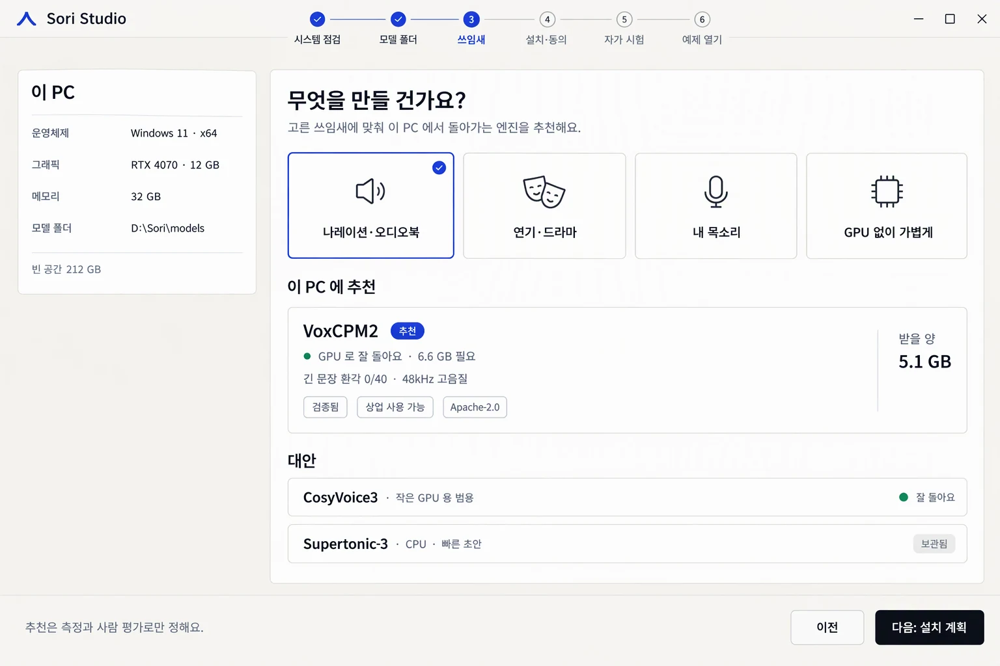
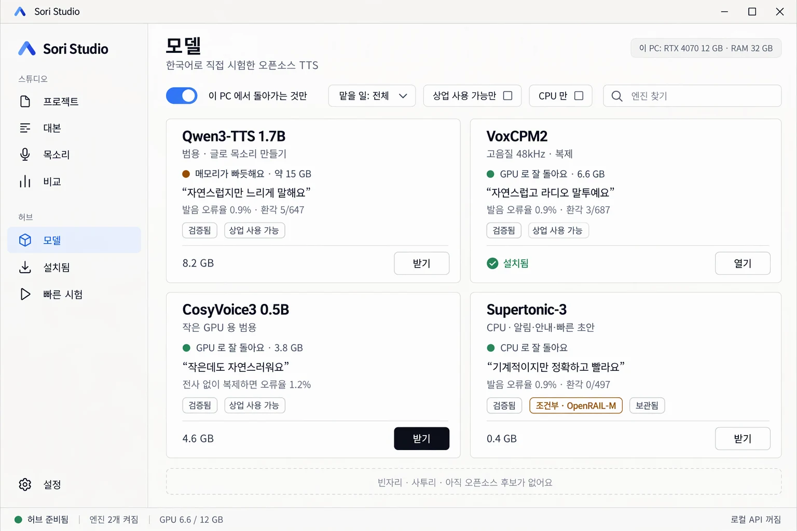
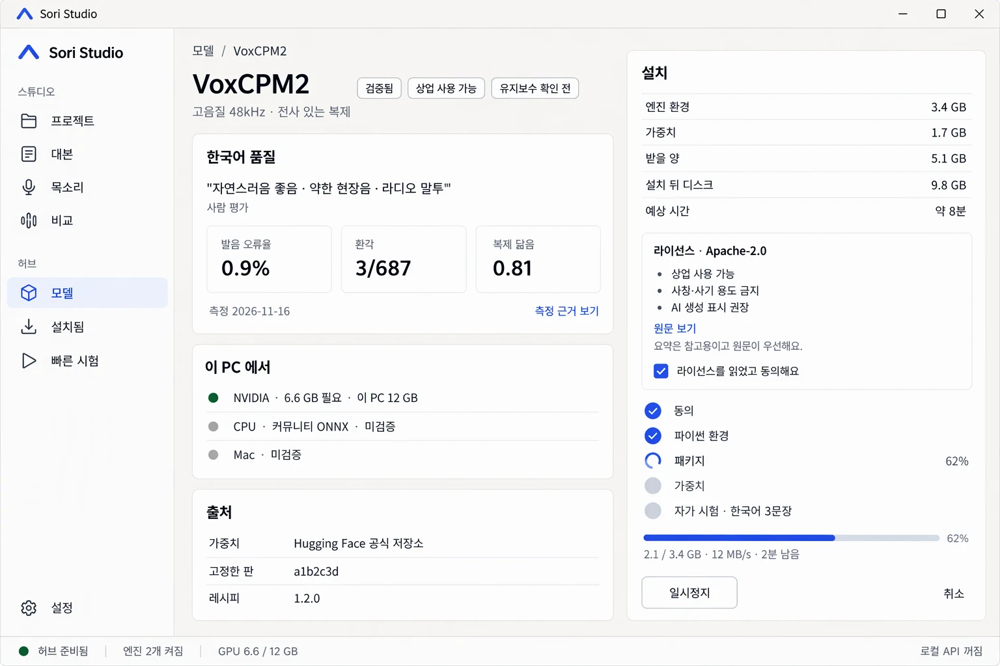
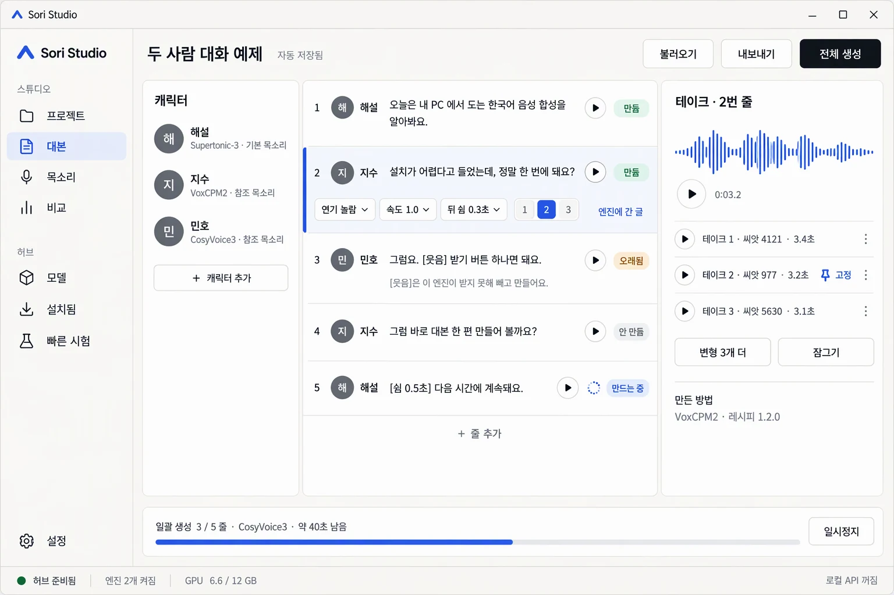
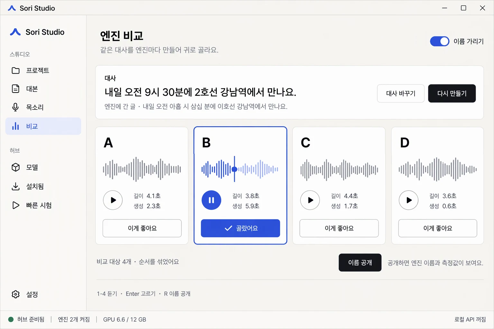
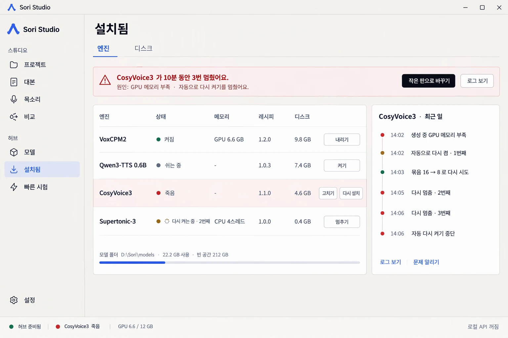
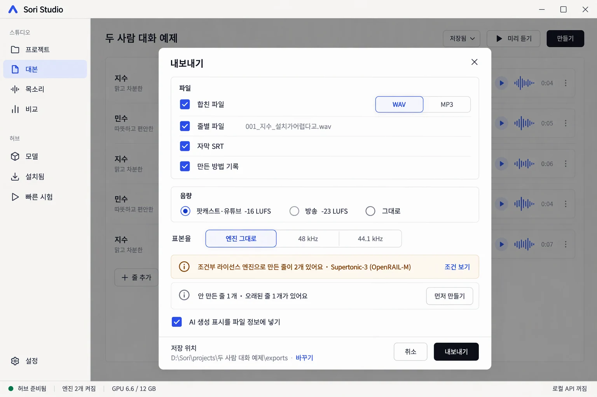
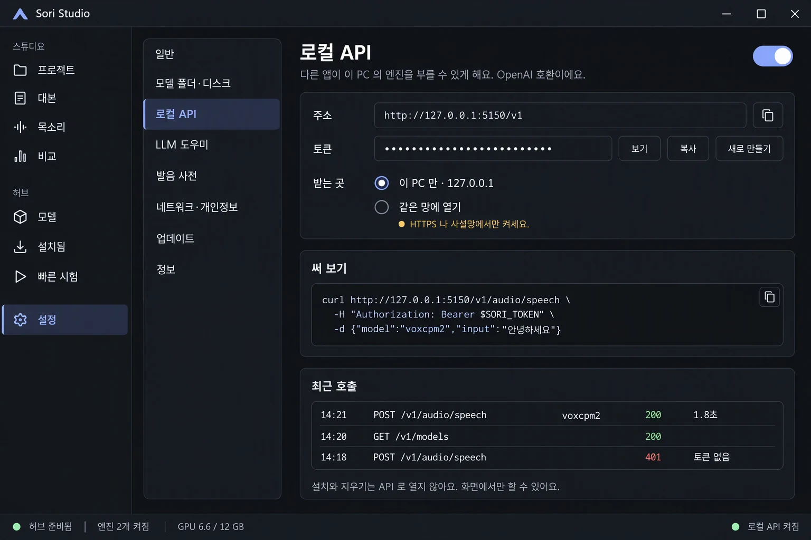

# Sori Studio(소리 스튜디오) 화면 설계서 (v0.1, 2026-11-17)

> 기능 설계 [`../sori-studio-features.md`](../sori-studio-features.md)(v0.3, 정본)의 **MVP(P0·P1)** 를 화면으로 옮긴 문서예요. 여기서 기능을 새로 만들지 않아요. 화면을 그리다 기능 설계와 어긋나거나 빠진 것은 맨 끝 [13절](#13-기능-설계에-돌려줄-것)에 모았어요.
> 구현용 부품 규칙은 [`components.md`](components.md), 예상 화면 그림은 [`mockups/`](mockups/)에 있어요. **그림과 이 문서가 다르면 이 문서가 맞아요**(11절).
> 괄호 안 숫자(예: 4.8)는 기능 설계의 절 번호예요.

## 0. 한눈에
- **틀**: 왼쪽 내비게이션(스튜디오 4 · 허브 3 · 설정) + 가운데 작업 면 + 맨 아래 **상태 줄**(허브·엔진·GPU 메모리·작업 큐가 늘 보임).
- **화면 수**: 내비게이션 항목 8개(프로젝트·대본·목소리·비교 / 모델·설치됨·빠른 시험 / 설정)와 틀 화면 3개(시작·복구 모드·첫 실행 마법사)예요. voicestudio 의 작업 화면 약 17개 + 설정 19칸을 따라가지 않아요.
- **색**: 종이빛 밝은 면 + 잉크 검정 주 단추 + 강조색 **쪽빛 하나**. 초록·호박·빨강은 상태를 알릴 때만 써요.
- **가장 공들이는 곳**: 첫 실행 마법사, 설치 진행, 엔진이 죽었을 때 화면이에요. 로컬 TTS 앱의 불만은 기능이 아니라 설치·실행에서 나오기 때문이에요(voicestudio 이슈 제목의 약 25% 가 백엔드 연결·죽음, 약 9% 가 설치).

---

## 1. 디자인 원칙
1. **되는지부터 보여 줘요.** 엔진 이름보다 "이 PC 에서 돌아가나"가 먼저 보여요. 카드·목록·마법사 어디서나 판정(잘 돌아요 / 느리게 돌아요 / 안 돌아요)이 이름 바로 아래에 있어요.
2. **뭉뚱그리지 않아요.** "연결할 수 없음" 같은 한 줄 오류를 쓰지 않아요. 지금 어느 단계인지, 왜 멈췄는지, 다음에 누를 단추가 무엇인지를 늘 함께 보여 줘요(10.3).
3. **초보는 첫 실행에 성공해요.** 마법사는 한 화면에 결정 하나만 두고, 추천 하나 + 대안을 줘요. 숫자·용어에는 쉬운 말을 한 줄 붙여요.
4. **고수는 빠르게 해요.** 대본 에디터의 모든 일(줄 이동·듣기·다시 만들기·테이크 고르기)이 키보드로 되고, 자주 쓰는 값은 줄 안에서 바로 고쳐요. 숨은 메뉴를 거치지 않아요.
5. **오픈소스 도구다운 신뢰감을 줘요.** 꾸밈보다 사실이에요. 측정값에는 날짜와 근거 링크가, 내려받기에는 출처·판·용량이, 네트워크를 쓰는 단추에는 "인터넷을 써요" 표시가 붙어요. 광고·가입 권유·배너가 없어요.
6. **한국어가 먼저예요.** 글꼴·줄 간격·줄바꿈을 한글 기준으로 잡고, 문구는 해요체예요. 영어는 고유 이름과 꼭 필요한 용어에만 써요(10.2).
7. **허브와 스튜디오는 한 앱의 두 층이에요.** 스튜디오에서 엔진 문제를 만나면 그 자리에서 허브 상태가 보이고, 허브에서 받은 엔진은 바로 스튜디오에서 쓸 수 있어요.
8. **제안은 제안처럼 보여요.** LLM 이나 자동 번역이 바꾼 것은 사용자가 쓴 것과 다르게 표시하고, 적용은 사용자가 눌러요(6.2).
9. **조용한 화면이에요.** 강조색은 하나, 움직임은 진행·재생을 알릴 때만, 알림은 꼭 필요할 때만 띄워요.

---

## 2. 브랜드

### 2.1 이름·로고
- 표기: 앱은 **Sori Studio**, 한국어 설명에서는 **소리 스튜디오**. 창 제목·내비게이션 맨 위·설치 파일은 "Sori Studio" 예요. 저장소·명령은 `sori-studio`.
- 화면 어디에도 회사·서비스 이름을 넣지 않아요. "Made by ModuVoice" 는 설정 > 정보에 한 줄만 있어요(8.2).
- **로고 아이디어(추천 순)**
  1. **시옷 봉우리**: '소리'의 첫 글자 **ㅅ** 을 둥근 획 두 개로 그려요. 파형의 봉우리로도, 위를 가리키는 꺾쇠로도 읽혀요. 16px 아이콘에서도 알아볼 수 있어요. 이 문서의 목업은 이 안으로 그렸어요.
  2. **ㅅ + 파형 막대**: 세로 막대 다섯 개의 높이가 ㅅ 모양을 이뤄요. 더 "오디오 도구"처럼 보이지만 작은 크기에서 뭉개져요.
  3. **글자 표지**: 마크 없이 `Sori` 워드마크만(굵기 700, 자간 -1%). 가장 수수해요.
- 마크는 쪽빛 한 색(다크에서는 밝은 쪽빛), 워드마크는 잉크색이에요. 그러데이션·입체·마스코트는 쓰지 않아요.
- 앱 아이콘: 잉크 검정 둥근 사각형 위에 흰 ㅅ 봉우리(작업 표시줄에서 밝은·어두운 배경 모두에 보이게).
- 상표·앱스토어 이름은 아직 확인 전이라(기능 설계 열린 질문 2) 로고는 공개 전에 한 번 더 봐요.

### 2.2 색 원칙
- **주 행동은 잉크 단색 단추** 하나예요(화면마다 주 단추는 하나).
- **강조색은 쪽빛 하나**예요. 선택된 것, 링크, 파형·재생 위치, 진행 막대, 포커스 고리에만 써요. 넓은 면을 쪽빛으로 칠하지 않아요.
- **상태색 셋**(초록 = 됨·켜짐, 호박 = 주의·오래됨·조건부, 빨강 = 실패·죽음)은 점·배지·알림 띠에만 써요. 색만으로 뜻을 전하지 않고 **늘 글자나 아이콘을 같이** 둬요.
- 캐릭터·엔진을 색으로 구분하지 않아요(색이 늘면 상태색과 섞여요). 이름 칩과 머리글자 동그라미로 구분해요.
- 파스텔 무지개 태그, 이모지, 그러데이션은 쓰지 않아요.

### 2.3 디자인 토큰 - 색
대비는 WCAG 2.x 명도 대비로 계산했어요(글자 4.5:1 이상, 큰 글자·아이콘·입력 테두리 3:1 이상이 기준).

| 토큰 | 쓰임 | 라이트 | 다크 | 대비(라이트 / 다크) |
|---|---|---|---|---|
| `canvas` | 창 바탕 | `#F6F5F1` | `#101216` | - |
| `surface` | 카드·패널·입력 | `#FFFFFF` | `#181B21` | - |
| `raised` | 메뉴·모달·떠 있는 것 | `#FFFFFF` | `#20242C` | - |
| `sunken` | 움푹한 면(코드·파형 바탕·진행 홈) | `#EEECE6` | `#0B0D10` | - |
| `line` | 구분선·카드 테두리(꾸밈) | `#E2DFD6` | `#2A2F38` | 꾸밈이라 기준 없음 |
| `line-strong` | 입력·체크 상자 테두리 | `#8F8B7E` | `#6B7280` | surface 위 3.4 / 3.6 |
| `ink-900` | 본문·제목 | `#16181D` | `#ECEEF2` | surface 위 17.8 / 14.9 |
| `ink-700` | 버금 본문 | `#3A3E47` | `#C5C9D1` | 10.7 / 10.4 |
| `ink-500` | 보조 글·설명·라벨 | `#5F6470` | `#9BA1AD` | 5.9(canvas 5.4, sunken 5.0) / 6.7 |
| `ink-400` | 자리 표시 글·꺼진 것(글자로 뜻을 전하지 않을 때만) | `#8A8F9A` | `#737A87` | 3.2 / 4.0 |
| `accent` | 강조(선택·링크·파형·진행·포커스) | `#2F55D4` | `#8EA6FF` | 6.2(canvas 5.7) / 7.4 |
| `accent-strong` | 강조 위 글자, 누름 | `#2546B8` | `#B4C3FF` | accent-soft 위 6.8 / 8.6 |
| `accent-soft` | 선택된 줄·내비게이션 바탕 | `#E8EDFC` | `#1C2646` | - |
| `action` | 주 단추 바탕 | `#16181D` | `#ECEEF2` | 단추 글자 17.8 / 16.1 |
| `on-action` | 주 단추 글자 | `#FFFFFF` | `#101216` | - |
| `success` | 됨·켜짐·만듦 | `#1F7A4D` | `#5CC48D` | 5.3 / 8.0 |
| `success-soft` / 그 위 글자 | 알림 띠 바탕 | `#E3F3EA` / `#17603C` | `#15301F` / `#8ADDB0` | 6.6 / 8.9 |
| `warning` | 주의·오래됨·조건부 | `#8F5A00` | `#E9B44C` | 5.8 / 9.1 |
| `warning-soft` / 그 위 글자 | 알림 띠 바탕 | `#FBF0D9` / `#7A4D00` | `#33270F` / `#F2CC7E` | 6.4 / 9.5 |
| `danger` | 실패·죽음·지우기 | `#C0362C` | `#F0776C` | 5.5 / 6.2 |
| `danger-soft` / 그 위 글자 | 알림 띠 바탕 | `#FBE9E7` / `#A32B22` | `#3A1A17` / `#F6A59D` | 6.1 / 8.1 |
| `scrim` | 모달 뒤 가림 | `rgba(22,24,29,.45)` | `rgba(0,0,0,.6)` | - |

- 다크 모드는 **같은 토큰 이름에 값만 바뀌어요**. 화면마다 다크 전용 규칙을 두지 않아요. 기본은 운영체제 설정을 따르고 설정 > 일반에서 고를 수 있어요(시스템 / 밝게 / 어둡게).
- 다크의 주 단추는 밝은 면(`#ECEEF2`)에 어두운 글자예요(잉크 단추를 뒤집은 것).
- `ink-400` 은 대비가 낮아서 읽어야 하는 글에 쓰지 않아요.

### 2.4 디자인 토큰 - 글자
| 토큰 | 크기 / 줄 높이 | 굵기 | 쓰임 |
|---|---|---|---|
| `display` | 28 / 36 | 700 | 마법사 질문, 빈 화면 제목 |
| `h1` | 22 / 30 | 700 | 화면 제목 |
| `h2` | 17 / 26 | 600 | 카드·구역 제목, 엔진 이름 |
| `h3` | 15 / 22 | 600 | 작은 구역 제목 |
| `script` | 15 / 24 | 400 | **대본 글**(가장 오래 읽는 글이라 한 단계 큼) |
| `body` | 14 / 22 | 400 | 본문 |
| `label` | 13 / 18 | 500 | 단추·라벨·내비게이션·배지 |
| `caption` | 12 / 16 | 400 | 보조 정보·상태 줄. **12px 아래는 쓰지 않아요** |
| `mono` | 13 / 20 | 400 | 주소·토큰·판·씨앗·로그 |

- **글꼴**: 화면은 **Pretendard**(가변, SIL OFL - 앱에 함께 넣어요), 고정폭은 **JetBrains Mono**(OFL)에 한글은 **D2Coding**(OFL)으로 받쳐요. 시스템 글꼴 대체는 `"Pretendard Variable", Pretendard, -apple-system, "Segoe UI", "Malgun Gothic", sans-serif`.
- **한글 규칙**: `word-break: keep-all`(낱말 중간에서 줄을 바꾸지 않음), 제목은 `text-wrap: balance`, 한글에 양수 자간을 주지 않아요. 제목만 자간 -1%.
- **숫자**: 용량·시간·오류율·씨앗은 `font-variant-numeric: tabular-nums`(자릿수가 흔들리지 않게).
- 영문 대문자 라벨(LIBRARY 같은 것)은 쓰지 않아요.

### 2.5 디자인 토큰 - 간격·모서리·그림자·움직임
| 묶음 | 토큰 | 값 |
|---|---|---|
| 간격 | `space-1` ~ `space-8` | 4 · 8 · 12 · 16 · 20 · 24 · 32 · 48 (4px 격자) |
| 모서리 | `radius-control` / `radius-card` / `radius-sheet` / `radius-pill` | 8 / 10 / 14 / 999 |
| 높이 | 단추·입력 `sm` / `md` / `lg` | 28 / 32 / 40 |
| 누르는 곳 | 최소 크기 | 28×28(데스크톱 마우스 기준), serve 모드 좁은 창에서는 36×36 |
| 그림자 | `shadow-float` | 메뉴·모달·토스트에만. 카드는 그림자 대신 `line` 테두리 |
| 포커스 | `focus-ring` | 2px `accent` + 2px 띄움. 키보드로 옮길 때 늘 보여요 |
| 움직임 | `motion-fast` / `motion-base` | 120ms / 200ms, ease-out. 운영체제 "동작 줄이기"가 켜져 있으면 진행 표시 말고는 끔 |

### 2.6 아이콘
- **Lucide**(ISC) 한 벌만 써요. 선 굵기 1.5px, 크기 16(줄 안)·18(내비게이션)·20(빈 화면).
- 아이콘만 있는 단추는 반드시 말풍선 글(툴팁)과 `aria-label` 을 달아요.
- 상태는 아이콘 모양으로도 구분해요: 됨 = 체크, 주의 = 세모 느낌표, 실패 = 동그라미 가위표, 진행 = 도는 고리, 잠금 = 자물쇠, 고정 = 압정.
- 남의 로고(NVIDIA·Hugging Face·모델 회사)는 쓰지 않고 글자로 적어요.

### 2.7 접근성 기준
- 글자 대비 4.5:1 이상, 큰 글자(18px 이상 또는 14px 굵게)·아이콘·입력 테두리 3:1 이상(2.3 표가 근거).
- 모든 기능이 키보드로 돼요. 포커스 순서는 화면에 보이는 순서와 같아요.
- 색만으로 상태를 알리지 않아요(점 + 글자, 배지 + 아이콘).
- 소리 재생은 사용자가 누를 때만 시작해요(자가 시험도 "듣기"를 눌러야 나와요).
- 진행·오류는 화면 낭독기에 알려요(`aria-live`: 진행은 polite, 엔진 죽음·설치 실패는 assertive).
- 창 글자 크기 90~130% 확대(설정 > 일반)에서 줄이 잘리지 않아요.

---

## 3. 정보 구조·내비게이션

### 3.1 허브와 스튜디오의 관계
```
Sori Studio
├─ 스튜디오 ─ 대본을 완성 음성으로
│   ├─ 프로젝트      프로젝트 목록·새로 만들기·예제
│   ├─ 대본          대본 에디터(열려 있는 프로젝트) ─ 캐릭터 · 테이크 · 일괄 생성 · 내보내기 · LLM 도우미
│   ├─ 목소리        기본 목소리 · 참조 목소리 · 설계 목소리 · 동의 기록
│   └─ 비교          같은 대사를 엔진 2~4개로(P1)
├─ 허브 ─ 엔진을 받고·돌리고·살피기
│   ├─ 모델          카탈로그 → 모델 상세 → 설치
│   ├─ 설치됨        엔진 상태(켜짐·죽음…) · 디스크 · 판
│   └─ 빠른 시험     대본 없이 한 줄 듣기
└─ 설정              일반 · 모델 폴더·디스크 · 로컬 API · LLM 도우미 · 발음 사전 · 네트워크·개인정보 · 업데이트 · 정보
(틀) 시작 화면 → [첫 실행이면] 마법사 → 앱   /   허브가 못 켜지면 복구 모드
```
- **왼쪽 내비게이션에서 스튜디오가 위, 허브가 아래**예요. 날마다 하는 일(대본)이 위에 있고, 가끔 하는 일(받기·살피기)이 아래 있어요. 제품의 중심은 허브지만(기능 설계 결정 2), 화면에서 허브가 중심이라는 것은 순서가 아니라 **허브만으로 끝까지 쓸 수 있다**는 것으로 지켜요: 모델 → 설치 → 빠른 시험 → 로컬 API 까지 스튜디오를 한 번도 안 열고 돼요.
- 첫 실행 뒤 처음 열리는 화면은 예제 프로젝트의 **대본**이에요(7.2). 그 뒤로는 마지막에 보던 화면을 열어요.
- **두 층을 잇는 길**
  - 대본에서 엔진을 고르는 곳마다 엔진 상태 점이 있고, 설치 안 된 엔진은 "받기"로 모델 상세에 가요.
  - 모델 상세·설치됨에서 "빠른 시험", "이 엔진으로 캐릭터 만들기"로 스튜디오에 가요.
  - 맨 아래 **상태 줄**은 어느 화면에서나 허브·엔진·GPU 메모리·작업 큐를 보여 주고, 누르면 설치됨(엔진 탭)이나 큐 패널이 열려요.
- 깊이는 두 단계까지예요(목록 → 상세). 그보다 깊은 일은 모달·옆 패널로 처리해요.

### 3.2 앱 틀(공통)
| 구역 | 크기 | 내용 |
|---|---|---|
| 제목 줄 | 36px | 창 제목(화면 이름 · 프로젝트 이름), 가운데 **빠른 이동**(Ctrl+K), 오른쪽 창 단추. macOS 는 왼쪽 신호등 단추 자리를 비워요 |
| 내비게이션 | 208px(좁은 창 64px, 아이콘만) | 로고, 스튜디오 4 · 허브 3, 맨 아래 설정. 항목 옆 작은 표시: 모델(받는 중이면 진행 고리), 설치됨(죽은 엔진이 있으면 빨간 점) |
| 작업 면 | 나머지 | 화면마다 다름. 위에 화면 제목 줄(제목·주 단추) |
| 상태 줄 | 28px | 왼쪽부터 허브 상태 · 엔진 상태 요약 · GPU 메모리(쓰는 양 / 전체) · 작업 큐(진행 중이면 "3 / 12 줄 · 약 2분"), 오른쪽 끝 로컬 API 켜짐/꺼짐 |

- **상태 줄의 허브 상태**: 준비됨(초록 점) / 켜는 중(고리) / 다시 켜는 중(호박) / 멈춤(빨강, 누르면 복구 모드).
- **상태 줄의 엔진 요약**: "엔진 2개 켜짐", 문제가 있으면 "CosyVoice3 죽음"(빨강)처럼 가장 나쁜 것 하나를 이름으로 보여 줘요.
- **빠른 이동(Ctrl+K)**: 화면·프로젝트·엔진·설정 칸 이름으로 찾아가는 창이에요. 새 기능이 아니라 이미 있는 화면으로 가는 지름길이에요.
- **알림**: 사용자가 방금 한 일의 결과는 토스트(오른쪽 아래, 4초), 사용자가 꼭 봐야 하는 문제(엔진 죽음·설치 실패·디스크 부족)는 그 화면의 **알림 띠**로 남겨요. 문제를 토스트로만 흘려 보내지 않아요.

---

## 4. 창 크기와 레이아웃

### 4.1 데스크톱(Electron)
| 구간 | 창 너비 | 틀 |
|---|---|---|
| **최소** | 1120 × 720 | 이보다 줄일 수 없어요. 내비게이션은 64px 아이콘, 대본의 캐릭터 패널은 접힘(단추로 펼침), 테이크 패널은 오른쪽에서 나오는 서랍(320px) |
| **기본** | 1280 ~ 1679 (처음 창 1440 × 900) | 내비게이션 208px. 대본은 캐릭터 220 · 대본(나머지) · 테이크 320 세 칸 |
| **넓은 창** | 1680 이상 | 대본 글 칸은 최대 880px 로 묶고(한 줄이 너무 길면 읽기 어려워요) 남는 너비는 테이크 패널(최대 440px, 파형이 커져요)에 줘요. 카탈로그는 카드 3열, 설치됨은 표 옆에 최근 일 패널이 늘 보여요 |

- 화면별 가운데 면 최대 너비: 카탈로그·설치됨 1200px, 모델 상세 1120px, 설정·빠른 시험 760px, 마법사 960px. 넓은 모니터에서 내용이 양끝으로 흩어지지 않게 해요.
- 창 크기·위치·패널 너비·마지막 화면은 기억해요.
- 세로가 720px 일 때도 주 단추가 스크롤 없이 보이게, 마법사·모달의 바닥 단추 줄은 고정해요.

### 4.2 serve 모드(브라우저)에서 달라지는 점
같은 웹 화면을 브라우저로 여는 것이라 틀은 같아요. 다른 점만 적어요.

| 항목 | 데스크톱 | serve 모드 |
|---|---|---|
| 들어가기 | 바로 열림(토큰을 껍데기가 넘겨줌) | **토큰 넣는 화면**이 먼저 나와요. 주소 줄에 토큰을 넣지 않아요 |
| 제목 줄 | 자체 제목 줄 | 없음(브라우저 탭 제목). 빠른 이동은 내비게이션 위로 |
| 어디에 붙었는지 | 표시 없음 | 내비게이션 맨 위 로고 아래 **"○○(주소)의 허브"** 칩. 판정 문구도 "이 PC" 대신 **"허브 PC"** |
| 파일·폴더 | 운영체제 창 | 불러오기는 올리기, 내보내기는 내려받기(zip). 모델 폴더·프로젝트 폴더는 **허브 PC 의 경로**라고 적고 글자로 넣어요 |
| 허브가 죽을 때 | 껍데기가 다시 켜고 복구 모드 | 다시 켤 수 없어요. "허브에 닿지 않아요 · 허브 PC 에서 `sori-studio doctor` 를 돌려 보세요" 화면 + 자동 다시 붙기 |
| 같은 망 경고 | - | HTTPS 가 아니고 사설망도 아니면 위에 호박 알림 띠 |
| 앱 업데이트 | 설정 > 업데이트 | 숨김(허브 PC 에서 함) |
| 최소 너비 | 1120 | 1024 까지(내비게이션 64px). 그 아래는 "창을 넓혀 주세요" 안내만 - 휴대폰 화면은 범위가 아니에요 |
| 녹음(참조 클립) | 됨 | HTTPS 나 localhost 일 때만 브라우저가 마이크를 줘요. 안 되면 "파일 올리기"만 보여요 |

---

## 5. 화면 목록
상태 이름: **빈** = 내용이 없을 때 / **불러오는 중** / **오류** / 그 밖의 화면별 상태. 단축키는 Windows 기준이고 macOS 는 Ctrl 대신 Cmd 예요(전체 표는 9절).

### A1. 시작 화면 (4.8 겹 1)
- **목적**: 허브 서버가 켜지는 동안 "어디까지 왔는지"를 보여 줘요.
- **구성**: 가운데 로고, 그 아래 네 단계 목록 - **파이썬 확인 → 서버 켜는 중 → 엔진 목록 읽는 중 → 준비**. 단계마다 체크·도는 고리·걸린 시간.
- **상태**
  - 보통: 2초 안에 끝나면 단계 목록 없이 로고만 보였다가 넘어가요(깜박임 방지).
  - 오래 걸림(단계 시간 한도의 절반을 넘김): "평소보다 오래 걸려요 · 로그 보기".
  - 단계 실패: 그 단계에 빨간 표시 + **원인과 단추**. 예: 포트 사용 중 → "이미 켜져 있는 허브에 붙을게요"(자동), 파이썬 막힘 → 백신·서명 안내, 의존성 깨짐 → "고치기", 디스크 가득 → "정리하러 가기", 모름 → "로그 보기".
  - 자동 다시 켜기: "허브를 다시 켜는 중이에요 (2 / 3)". 10분에 3번을 넘으면 A2 로 가요.

### A2. 복구 모드 (4.8)
- **목적**: 허브가 스스로 못 일어날 때 사용자가 고를 수 있는 길을 줘요.
- **구성**: 내비게이션 없이 한 장. 위에 무슨 일이 있었는지(마지막 단계·원인 한 줄·시각), 아래 세 가지 선택 카드 - **로그 보기**(키·경로를 가린 로그, 복사·저장), **환경 고치기**(허브 파이썬 환경을 잠금 파일대로 다시 맞춤, 프로젝트·모델은 그대로), **깨끗이 다시 설치**(허브 런타임만 다시, 지워지는 것과 남는 것을 목록으로). 맨 아래 "문제 알리기"(미리 채운 GitHub 이슈, 보낼 내용을 먼저 보여 줌)와 "공식이 아닌 '고침 도구'를 받지 마세요" 한 줄(7.5).
- **상태**: 고치는 중(단계 진행), 고침 성공("다시 켜기"), 고침 실패(다음 선택 권유).
- 프로젝트·테이크·받은 모델은 어떤 선택에서도 지우지 않는다는 것을 화면에 적어요.

### A3. 첫 실행 마법사 (7.2, 4.3~4.5, 4.11)
- **목적**: 설치부터 첫 소리까지 한 번에 가요. 흐름은 6.1 에 단계별로 적었어요.
- **구성**: 내비게이션·상태 줄 없이 한 장. 위에 6단계 표시(시스템 점검 · 모델 폴더 · 쓰임새 · 설치·동의 · 자가 시험 · 예제 열기), 왼쪽에 "이 PC" 요약 카드(2단계부터 늘 보임), 가운데 단계 내용, 아래 고정 단추 줄(이전 / 다음).
- **상태**: 점검 중, GPU 없음(바로 CPU 길), 드라이버 오래됨, 디스크 부족, 오프라인(받기 단계에서 멈춤 + 이어받기), 설치 실패(분류별), 자가 시험 실패, 건너뛰기("나중에 고를게요" - 엔진 없이 앱으로).
- **단축키**: Enter 다음, Alt+← 이전, 숫자 1~4 쓰임새 고르기.
- 그림: `mockups/01-wizard.png`

### H1. 모델(카탈로그) (4.1~4.3, 4.5, 4.11)
- **목적**: 어떤 엔진이 있고, 이 PC 에서 되는지, 무엇에 좋은지, 써도 되는지(라이선스)를 한눈에 봐요.
- **구성**
  - 제목 줄: "모델", 오른쪽에 이 PC 요약 칩(GPU 이름·메모리·RAM, 누르면 자세히), "새 엔진 확인"(인터넷을 쓰는 단추라 지구본 표시).
  - 거르기 줄: **"이 PC 에서 돌아가는 것만"**(기본 켬) · 맡을 일 · CPU 만 · 찾기 ("상업 사용 가능만" 거르기는 넣지 않아요, 오픈소스 허브라서. 라이선스는 배지·동의로만 알려요). 걸러서 숨긴 것이 있으면 목록 끝에 "숨긴 엔진 N개 보기".
  - **엔진 카드**(components.md 4): 이름·만든 곳 / 맡을 일 / **판정** / 사람 평가 한 줄 / 측정값 한 줄(발음 오류율·환각, 근거 등급 배지) / 라이선스 배지 · 유지보수 배지 / 디스크 · 단추(받기 · 받는 중 n% · 열기).
  - 카드 순서는 추천 순서(4.3: 측정·사람 평가)예요. 라이선스·유지보수 때문에 순서를 바꾸거나 숨기지 않고 배지로만 보여 줘요.
  - 목록 끝 **빈자리 줄**: "사투리 - 아직 오픈소스 후보가 없어요"(4.2).
- **상태**: 빈(거르기에 걸린 게 없음 → "거르기 풀기"), 불러오는 중(카드 뼈대), 오프라인(카탈로그는 앱에 들어 있어 그대로 보이고 "받기"만 "인터넷이 필요해요"), 받는 중인 카드(진행 막대), 받기 실패 카드(빨간 줄 + "이어서 받기").
- **상호작용**: 카드 누르면 H2. "받기"는 H2 의 설치 패널을 연 채로 가요(동의를 건너뛰는 한 번 누르기 설치는 없어요).
- **단축키**: `/` 찾기, 방향키로 카드 이동, Enter 열기.
- 그림: `mockups/02-catalog.png`

### H2. 모델 상세·설치 (4.1, 4.4, 4.7, 4.11)
- **목적**: 엔진 한 장을 다 보여 주고, 같은 화면에서 설치를 끝내요.
- **구성**(두 칸)
  - 왼쪽: **한국어 품질**(사람 평가, 측정값 타일, 근거 등급, 측정 날짜·조건, "측정 근거 보기" → 저장소 안 측정 페이지), **이 PC 에서**(장치별 판정: NVIDIA·CPU·Mac, 미검증은 "미검증"), **할 수 있는 것**(복제 방식·권장 참조 길이, 글로 목소리 만들기, 연기 지시 자리와 안전한 지시 언어, 확인된 태그 / 미확인 태그, 묶음 크기), **라이선스**(코드·가중치·출력물·상업·호스팅·표시 의무·용도 제한 원문 링크), **유지보수**(활발 / 조용 / 보관됨, 마지막 갱신일, 보관 저장소 주소), **출처**(가중치·코드 주소, 고정한 판, 레시피 판).
  - 오른쪽(고정 패널, 420px): **설치 패널**. 상태에 따라 바뀌어요 - 계획 → 동의 → 진행 → 자가 시험 → 설치됨(6.2).
- **상태**: 안 받음 / 계획 보기 / 동의 기다림 / 받는 중(단계·속도·남은 시간) / 일시정지 / 실패(분류 + 고치기) / 자가 시험 중 / 자가 시험 실패 / **설치됨**(판·디스크·"빠른 시험"·"지우기") / 업데이트 있음 / 출처 바뀜·사라짐(4.7) / 이 PC 에서 안 돌아요("그래도 설치" 는 경고와 함께 버금 단추로).
- **단축키**: Esc 목록으로, Space 자가 시험 소리 듣기.
- 그림: `mockups/03-model-install.png`

### H3. 설치됨 (4.6, 4.7, 4.8)
- **목적**: 받은 엔진의 **지금 상태**와 **디스크**를 살피고 손봐요. 엔진이 죽었을 때 오는 곳이에요.
- **구성**: 탭 둘.
  - **엔진 탭**: 엔진 표(이름 · 상태 · 메모리 · 레시피 판 · 디스크 · 할 일). 줄을 누르면 오른쪽 **최근 일** 패널(그 엔진의 시작·멈춤·다시 켬·오류 시간순, "로그 보기"). 문제가 있으면 맨 위 알림 띠(무슨 일 · 원인 · 주 단추 하나).
  - **디스크 탭**: 모델 폴더 위치·드라이브 빈 공간 막대, 엔진별 용량(환경 · 가중치 · 캐시로 나눈 막대), 함께 쓰는 캐시(uv·HF), 프로젝트 테이크 용량. 지우기 메뉴(엔진 통째 / 환경만 / 가중치만 / 캐시) - 확인 창에 **되찾는 용량**. "모델 폴더 옮기기", "찌꺼기 찾기".
- **엔진 실행 상태**(4.8 겹 2): 켜짐 / 불러오는 중 / 쉬는 중 / 멈춤 / 다시 켜는 중(n번째, 다음 시도까지 남은 시간) / 죽음. 표시 규칙은 components.md 5.
- **화면 상태**: 빈(받은 엔진 없음 → "모델 보러 가기"), 불러오는 중, 엔진 죽음(알림 띠), 디스크 부족(호박 띠 + 지울 후보), 옮기는 중(진행·취소, 그동안 엔진은 내려 둠).
- **상호작용**: 켜기 / 내리기 / 고치기(환경을 잠금 파일대로) / 다시 설치 / 지우기 / 로그 보기 / 문제 알리기. 죽음의 원인별 주 단추는 6.5.
- **단축키**: 방향키 줄 이동, Enter 최근 일 열기, R 다시 켜기, L 로그.
- 그림: `mockups/06-engine-status.png`

### H4. 빠른 시험 (5.3 끝)
- **목적**: 대본 없이 한 줄을 넣고 엔진·목소리를 골라 바로 들어요. 허브만 쓰는 사용자의 "됐나?" 확인 화면이에요.
- **구성**: 한 칸짜리 단순한 화면. 엔진 고르기(설치된 것만, 상태 점) · 목소리 고르기 · 글 입력(여러 줄) · "만들기" · 결과(파형·듣기·저장) · 접힌 "엔진에 간 글". 아래에 방금 만든 것 5개(다시 듣기).
- **상태**: 빈(설치된 엔진 없음 → "모델 받기"), 엔진 불러오는 중("처음에는 모델을 올리느라 오래 걸려요 · 약 n초"), 만드는 중(취소), 오류(엔진 죽음 → 자동 다시 켬 안내), 긴 글(엔진 한도를 넘으면 "문장 단위로 나눠 만들어요").
- **단축키**: Ctrl+Enter 만들기, Space 듣기.
- 로컬 API 가 켜져 있으면 결과 아래 "같은 요청을 API 로"(curl 한 줄 복사)를 보여 줘요.

### T1. 프로젝트 (5.3)
- **목적**: 프로젝트를 열고·만들고·옮겨요.
- **구성**: 프로젝트 줄 목록(이름 · 줄 수 · 길이 · 마지막 고침 · 폴더 위치), "새 프로젝트", "가져오기(zip)", 줄 메뉴(폴더 열기 · 묶어 내보내기 · 이름 바꾸기 · 목록에서 빼기). 프로젝트는 폴더 하나라서 "지우기"가 아니라 "목록에서 빼기"가 기본이고, 폴더까지 지우려면 따로 확인해요.
- **상태**: 빈("예제 프로젝트 열기" + "새 프로젝트"), 폴더를 못 찾음(줄에 "폴더가 없어요 · 다시 찾기").
- **단축키**: Ctrl+N 새 프로젝트, Enter 열기.

### T2. 대본(에디터) (5.1~5.3, 5.7)
- **목적**: 대본 한 편을 줄 단위로 만들고 고르고 내보내요. 앱에서 가장 오래 머무는 화면이에요.
- **구성**(세 칸 + 큐 줄)
  - 위 도구 줄: 프로젝트 이름(눌러 고침) · "자동 저장됨" · 되돌리기/다시 하기 · 불러오기 · 도우미(LLM 이 붙어 있을 때) · 내보내기 · **전체 생성**(주 단추, 옆 화살표로 범위: 전체 / 고른 줄 / 오래된 줄만 / 안 만든 줄만).
  - **캐릭터 패널**(왼쪽 220px): 캐릭터 줄(머리글자 · 이름 · 엔진 · 목소리 · 엔진 상태 점). 누르면 캐릭터 편집 팝오버(엔진 · 목소리 · 기본 연기 · 속도 · 음량). 엔진·목소리를 바꾸면 "이 캐릭터의 줄 n개를 다시 만들어야 해요 · 지금 다시 만들기".
  - **대본 칸**(가운데): 대본 줄 목록(components.md 7). 줄마다 번호 · 캐릭터 칩 · 대사(보이는 글) · 듣기 · 상태 배지. 고른 줄은 펼쳐져 **줄 설정**(연기 · 속도 · 뒤 쉼 · 이 줄만 엔진 바꾸기 · 테이크 칩 · "엔진에 간 글")과 **줄 아래 정보**(글자 수 · 예상 소리 길이 · 예상 생성 시간)가 보여요.
  - **테이크 패널**(오른쪽 320px): 고른 줄의 큰 파형 · 테이크 목록(씨앗 · 길이 · 만든 시각) · 고정 · 잠그기 · 이력에서 되돌리기 · **"변형 n개 더"(2~6)** · 나란히 듣기(A/B) · 만든 방법(엔진 · 레시피 판 · 목소리 · 씨앗 · 엔진에 간 글).
  - **큐 줄**(작업 면 아래, 만들 때만 보임): 진행(3 / 12 줄) · 지금 엔진 · 남은 시간 · 메모리 · 일시정지 / 재개 / 취소. 누르면 큐 패널(엔진별 묶음 순서, 실패한 줄 목록 · "실패한 줄만 다시").
- **줄 상태**: 안 만듦 / 기다림 / 만드는 중 / 만듦 / 오래됨 / 의심 / 실패, 그리고 따로 붙는 **잠금** 표시(components.md 7).
- **화면 상태**
  - 빈: "대본을 붙여 넣거나 파일을 끌어다 놓으세요"(TXT·CSV) + "빈 줄로 시작".
  - 엔진이 설치 안 된 캐릭터: 줄에 "엔진을 받아야 해요 · 받기".
  - 엔진 불러오는 중: 큐 줄에 "VoxCPM2 를 올리는 중이에요 · 약 20초".
  - 엔진 죽음: 그 엔진 줄들은 "기다림"으로 남고 큐 줄이 호박색으로 "CosyVoice3 를 다시 켜는 중 · 2번째". 다른 엔진 줄은 계속 만들어요. 3번 넘게 죽으면 그 엔진 줄만 "실패"가 되고 알림 띠(주 단추 + "설치됨에서 보기")가 떠요.
  - 앱을 다시 켰을 때 하던 큐가 있으면: "지난번에 만들던 줄이 7개 남았어요 · 이어서 만들기".
- **상호작용**
  - **넣기 메뉴**(대사 안에서 `[` 를 치거나 넣기 단추): 쉼 · 웃음 · 한숨 · 숨 · 울음 · 헐떡임 · 읽기 지정. **그 줄 엔진이 받는 표기만 켜지고**, 못 받는 것은 꺼진 채로 이유가 보여요("Supertonic-3 은 연기 지시를 받지 않아요"). 미확인 태그에는 "귀로 확인 필요" 표시.
  - 엔진이 못 받는 표기가 이미 대본에 있으면 지우지 않고, 줄 아래에 "[웃음]은 이 엔진이 받지 못해 빼고 만들어요"를 보여 줘요(대본은 그대로, 엔진 글에서만 빠져요).
  - **연기 칸**: 고정 목록 7개(기쁨·슬픔·화남·두려움·놀람·속삭임·차분) + 자유 글. 엔진이 못 받으면 칸이 꺼지고 이유가 보여요. Qwen3-TTS 에서 참조 목소리와 함께 쓰면 "연기 지시를 쓰는 줄은 기본 목소리로 만들어요" 안내.
  - **읽기 지정**: 낱말을 고르고 Ctrl+R → 읽기 입력 → 대본에는 원문이 밑줄로 보이고, "사전에 넣기"로 사용자 발음 사전에 보낼 수 있어요.
  - **엔진에 간 글**: 펼치면 보이는 글 / 엔진 글을 나란히 보여 주고 바뀐 곳을 표시해요(숫자 읽기 · 발음 사전 · 뺀 표기 · 영어로 옮긴 연기 지시).
  - 줄 끌어 옮기기, 여러 줄 고르기(Shift·Ctrl), 줄 합치기·나누기.
- **단축키**: 9절 표.
- 그림: `mockups/04-studio.png`

#### T2a. 불러오기 창 (5.3, 6.3)
- TXT·CSV 를 고르거나 붙여 넣으면 **미리 보기 표**(화자 · 대사)가 나와요. 나누는 규칙(`이름: 대사` · 따옴표 · 줄바꿈 · 문장 길이)을 고르고, 새로 나온 화자 이름을 캐릭터에 잇거나 새로 만들어요.
- LLM 이 붙어 있으면 "도우미로 정리"가 보여요(6.6).
- 상태: 화자를 못 찾음("모든 줄을 한 캐릭터로 넣을까요?"), 글자 깨짐(인코딩 고르기), 너무 김(줄 수·예상 시간 미리 알림).

#### T2c. 내보내기 창 (5.7, 4.11)
- **구성**: 파일(합친 파일 WAV/MP3 · 줄별 파일 · 자막 SRT · 만든 방법 기록) / 음량(팟캐스트·유튜브 -16 LUFS · 방송 -23 LUFS · 그대로) / 표본율(엔진 그대로 · 48k · 44.1k) / **라이선스 알림**(비상업·조건부 엔진으로 만든 줄 수와 엔진, 표시 의무 문구) / **점검**(안 만든 줄 · 오래된 줄 · 실패한 줄 수 + "먼저 만들기") / "AI 생성 표시를 파일 정보에 넣기"(기본 켬) / "만든 방법 기록에서 대본 글 빼기" / 저장 위치.
- **상태**: 만들 줄이 남음(내보내기는 되지만 "빠진 줄은 무음 없이 건너뛰어요"를 알리고 "먼저 만들기"를 주 단추로), 내보내는 중(진행), 끝남(토스트 + "폴더 열기"), 실패(디스크·권한).
- **단축키**: Ctrl+E 열기, Ctrl+Enter 내보내기.
- 그림: `mockups/07-export.png`

### T3. 목소리 (5.8)
- **목적**: 캐릭터에 쓸 목소리를 모으고 만들어요. 복제 동의를 여기서 기록해요.
- **구성**: 탭 셋 - **기본 목소리**(엔진별, 한국어에 맞는 것이 앞, 샘플 듣기) · **참조 목소리**(클립 + 전사, 엔진을 넘어 공용) · **설계 목소리**(묘사로 만들어 클립으로 고정한 것). 목소리 줄: 이름 · 종류 · 듣기 · 쓸 수 있는 엔진 · 동의 표시(본인 확인 / 허락 받음 / 기록 없음) · "캐릭터로 만들기".
- **참조 목소리 더하기**(옆 패널, 4단계): ① 녹음 또는 파일 올리기 → ② 자르기(파형 위에 **엔진별 권장 길이** 눈금, 잡음·음량 확인 결과) → ③ 전사 넣기·고치기(전사가 필요한 엔진에만 "필수" 표시) → ④ **동의**(본인 목소리: 화면의 동의 문장을 읽어 녹음 / 다른 사람: "녹음 당사자에게 허락을 받았어요" 확인 + 출처 메모).
- **설계 목소리 만들기**(옆 패널): 엔진 고르기(글로 목소리 만들기가 되는 엔진만) → 묘사 입력 → **후보 6개 뽑기** → 나란히 듣고 하나 고르기 → 이름 붙여 **클립으로 고정**. 위에 "같은 묘사라도 뽑을 때마다 달라져요. 한국어 묘사로는 성별이 잘 안 맞을 수 있어요"를 사실대로 적어요.
- **상태**: 빈(탭별 안내 + 주 단추), 복제되는 엔진이 없음("참조 목소리를 쓰려면 복제가 되는 엔진이 필요해요 · 모델 보기"), 클립이 너무 짧음·시끄러움(호박 안내, 막지는 않음), 본인 확인 실패("동의 녹음과 참조 클립의 목소리가 달라 보여요"), 동의 기록 없음(쓸 수는 있고 "묶어 내보내기는 동의 기록이 있어야 해요").
- **단축키**: Space 듣기, Ctrl+N 참조 목소리 더하기.

### T4. 비교 (5.4 간단판, P1)
- **목적**: 같은 대사를 엔진 2~4개로 만들어 귀로 골라요.
- **구성**: 대사 칸(직접 입력 또는 "대본에서 줄 가져오기", 아래 "엔진에 간 글") · 비교 대상 고르기(설치된 엔진·목소리 2~4개) · **후보 카드** 2~4장(글자 A~D 또는 엔진 이름 · 파형 · 듣기 · 길이 · 생성 시간 · "이게 좋아요") · **이름 가리기** 스위치 · "이름 공개" · 고른 뒤 "이 엔진을 캐릭터에 쓰기".
- **상태**: 빈(설치된 엔진이 2개 미만 → "비교하려면 엔진이 둘 이상 있어야 해요 · 모델 보기"), 만드는 중(카드마다 진행, GPU 엔진은 하나씩 올리느라 차례로 끝나요 - "엔진을 바꿔 올리는 중"), 한 엔진 실패(그 카드만 실패 + 다시), 이름 가림(카드에 글자만), 이름 공개(엔진 이름 · 목소리 · 측정값 한 줄).
- **단축키**: 1~4 듣기, Enter 고르기, R 이름 공개, Ctrl+Enter 다시 만들기.
- 기계 자연스러움 점수는 어디에도 보여 주지 않아요(5.4).
- 그림: `mockups/05-compare.png`

### G1. 설정
왼쪽에 칸 목록, 오른쪽에 내용(최대 760px). 바꾸면 바로 적용되고 "저장" 단추가 없어요(되돌릴 수 없는 일만 확인 창).

| 칸 | 내용 | 근거 |
|---|---|---|
| **일반** | 화면(시스템 / 밝게 / 어둡게), 글자 크기(90~130%), 처음 열 화면, 프로젝트 기본 폴더, CPU 엔진 스레드 수(기본 4) | 5.3 |
| **모델 폴더·디스크** | 모델 폴더 위치·옮기기, 드라이브 빈 공간, 캐시 지우기(설치됨 > 디스크 탭으로 가는 길도) | 4.6 |
| **로컬 API** | 켜기, 주소, 토큰(보기·복사·새로 만들기), 받는 곳(이 PC 만 / 같은 망에 열기), 써 보기(curl), 최근 호출 | 4.9 |
| **LLM 도우미** | 서버 주소(Ollama·LM Studio·llama.cpp 기본값 고르기), 모델, "연결 확인", 쓰임새별 모델(대본 정리 · 연기 제안), 원격 주소 넣기(경고) | 6.1 |
| **발음 사전** | 사용자 사전 표(낱말 · 읽기 · 메모), 더하기·고치기·지우기·CSV 가져오기/내보내기, "시험해 듣기", 한국어 글 다듬기 켜기 | 5.1 |
| **네트워크·개인정보** | **이 앱이 인터넷을 쓰는 일 목록**(모델·엔진 받기, 업데이트 확인, 사용자가 넣은 원격 LLM - 그 밖에는 없음), "텔레메트리 없음" 설명, 프록시·미러, 라이선스 동의 기록 보기 | 7.5 |
| **업데이트** | 앱 판, "하루 한 번 새 판 확인"(켜고 끄기), "지금 확인", 카탈로그 판·"새 엔진 확인" | 4.7 |
| **정보** | 판 · 라이선스(Apache-2.0) · 저장소 주소 · 오픈소스 고지 · **"Made by ModuVoice"** 한 줄 · 진단 정보 복사 · 로그 폴더 열기 | 8.2 |

- **단축키**: Ctrl+, 열기.
- 그림: `mockups/08-settings-api-dark.png`(로컬 API 칸, 다크)

---

## 6. 핵심 흐름

### 6.1 ① 첫 실행 마법사
설치 파일을 돌리면 A1(시작 화면)을 거쳐 마법사가 열려요.

| 단계 | 화면에 보이는 것 | 사용자가 하는 일 | 갈림 |
|---|---|---|---|
| **1 시스템 점검** | 항목이 하나씩 채워져요: 운영체제 · CPU · 메모리 · 그래픽(이름·메모리·드라이버) · 드라이브 빈 공간. 끝나면 한 줄 결론 - "GPU 로 도는 엔진을 쓸 수 있어요" / "GPU 가 없어요. CPU 로 도는 엔진으로 시작해요" | 보기만(자동), "다음" | 드라이버가 오래됨 → 필요한 판 안내 + "그래도 계속". GPU 여러 개 → 고르기 |
| **2 모델 폴더** | 드라이브 목록(빈 공간 막대), 기본 제안 폴더, "엔진 하나가 몇 GB 예요. 빈 공간이 넉넉한 드라이브를 고르세요" | 폴더 고르기 | 빈 공간이 모자람 → 호박 안내(막지는 않음). 쓸 수 없는 폴더 → 이유 |
| **3 쓰임새** | 네 가지 카드: 나레이션·오디오북 / 연기·드라마 / 내 목소리 / GPU 없이 가볍게. 고르면 아래에 **추천 엔진 1개 + 대안**(판정 · 근거 한 줄 · 배지 · 받을 양) | 쓰임새 고르기, 추천 그대로 또는 대안 고르기 | GPU 없음 → "GPU 없이 가볍게"가 미리 골라져 있고 나머지에는 "GPU 가 있어야 해요". "나중에 고를게요" → 6단계로 |
| **4 설치·동의** | ① **설치 계획**(받을 양 · 설치 뒤 디스크 · 예상 시간 · 출처·판) → ② **라이선스**(이름 · 요약 3~5줄 · 원문 링크 · "요약은 참고용이고 원문이 우선해요" · 동의 체크. OpenRAIL 계열은 요약 대신 **용도 제한 조항 원문**을 그대로 스크롤 상자에) → ③ **진행**(파이썬 환경 → 패키지 → 가중치, 단계별 체크, 속도·남은 시간) | 동의 체크 → "받기 시작" | 실패 → 분류별 안내와 "이어서 받기"(6.2). 창을 닫아도 다음에 이어서 |
| **5 자가 시험** | "한국어 3문장을 만들어 볼게요" → 문장마다 체크 → **"듣기"** 단추와 파형. 통과하면 "설치됐어요" | 듣기, "다음" | 실패 → 원인 + "다시 시험" / "다른 엔진 고르기". 통과 전에는 "설치됨"이 아니에요 |
| **6 예제 열기** | "두 사람 대화 예제를 열어 둘게요" + 마지막 확인 하나: "하루 한 번 새 판이 있는지 확인할까요?(판 번호만 물어봐요)" 켬/끔 | "시작하기" | 엔진을 건너뛴 경우 "모델 보러 가기"가 주 단추 |

- 받는 동안 기다리는 사람을 위해 4단계 진행 화면 아래에 "받는 동안 둘러보기"(앱으로 들어가고 진행은 상태 줄·모델 화면에 남음)를 둬요.
- 쓰임새별 추천은 MVP 엔진 4개 안에서만 해요(13절 3번).

### 6.2 ② 모델 카탈로그·설치·관리
1. **모델**에서 카드를 훑어봐요. 기본으로 이 PC 에서 돌아가는 것만 보여요.
2. 카드를 눌러 **모델 상세**로. 왼쪽에서 품질·장치·라이선스·유지보수·출처를 읽어요.
3. 오른쪽 설치 패널에서 "받기" → **계획 미리 보기**(엔진 환경 · 가중치 · 받을 양 · 설치 뒤 디스크 · 예상 시간). 디스크가 모자라면 여기서 **지울 후보**를 보여 줘요.
4. **라이선스 동의**(6.1 의 4단계와 같은 부품). 게이트 모델이면 "공식 페이지에서 동의하고 토큰을 넣어 주세요" 단계가 끼어요.
5. **진행**: 동의 ✓ → 파이썬 환경 → 패키지 → 가중치 → 자가 시험. 단계마다 체크포인트라 "일시정지", "이어서 받기"가 돼요. 진행은 상태 줄과 카드에도 보여요.
6. **실패하면** 설치 패널이 분류별 안내로 바뀌어요.

   | 분류 | 보이는 말 | 주 단추 |
   |---|---|---|
   | 디스크 | "디스크가 3.2 GB 모자라요." + 지울 후보 | 정리하기 / 다른 드라이브 |
   | 네트워크 | "받다가 끊겼어요. 받은 데까지는 남아 있어요." | 이어서 받기 (버금: 프록시·미러 설정) |
   | 드라이버·장치 | "그래픽 드라이버가 오래됐어요. 560 판 이상이 필요해요." | 드라이버 안내 보기 (버금: CPU 엔진 보기) |
   | 의존성 | "가속 부품 하나를 못 깔았어요. 없이도 돌아가요(조금 느려요)." | 가속 없이 계속 |
   | 권한·보안 | "보안 프로그램이 실행을 막았어요." | 예외 넣는 법 보기 |
   | 게이트 모델 | "이 모델은 공식 페이지에서 약관에 동의해야 받을 수 있어요." | 공식 페이지 열기 → 토큰 넣기 |
   | 알 수 없음 | "설치가 멈췄어요. 원인을 찾지 못했어요." | 로그 보기 (버금: 문제 알리기) |
7. **자가 시험 통과 → 설치됨.** 패널이 "빠른 시험", "이 엔진으로 캐릭터 만들기"로 바뀌어요.
8. **관리**는 **설치됨**에서 해요: 디스크 탭에서 용량 보기·지우기(환경만·가중치만·캐시)·폴더 옮기기, 엔진 탭에서 판 보기. 새 레시피가 나오면 줄에 "업데이트 있음" 배지가 붙어요(전후 비교는 v1).

### 6.3 ③ 대본 → 생성 → 테이크 비교 → 내보내기
1. **대본 넣기**: 프로젝트를 만들고 대본을 붙여 넣거나 TXT·CSV 를 끌어다 놓아요 → 불러오기 창에서 화자·대사 미리 보기 → 화자를 캐릭터에 이어요.
2. **캐릭터 정하기**: 캐릭터마다 엔진 + 목소리(+ 기본 연기·속도·음량). 설치된 엔진만 고를 수 있고, 엔진 옆에 판정·상태 점이 있어요.
3. **줄 다듬기**: 줄마다 연기·속도·뒤 쉼을 고치고, 필요하면 그 줄만 엔진을 바꿔요. 넣기 메뉴로 쉼·비언어·읽기 지정을 넣어요. "엔진에 간 글"로 숫자가 어떻게 읽힐지 확인해요.
4. **만들기**: 한 줄은 Ctrl+Enter, 전부는 "전체 생성". 큐 줄에 진행이 보이고, 줄 배지가 기다림 → 만드는 중 → 만듦으로 바뀌어요. 끝난 줄부터 바로 들을 수 있어요.
5. **듣기**: ↑↓ 로 줄을 옮기며 Space 로 들어요. "이어 듣기"(Shift+Space)는 고른 줄부터 끝까지 쉼을 넣어 이어 들려줘요.
6. **테이크 비교**: 마음에 안 드는 줄에서 "변형 3개 더" → 테이크 패널에서 1~6 으로 번갈아 듣고(A/B) 고정해요. 고정한 테이크가 내보내기에 쓰여요. 더 건드리지 않을 줄은 잠가요(일괄 생성이 건너뜀).
7. **고친 뒤**: 글·목소리·설정을 바꾸면 그 줄이 **오래됨**이 돼요. "전체 생성 ▾ 오래된 줄만"으로 그것만 다시 만들어요.
8. **내보내기**: Ctrl+E → 파일 종류·음량·표본율 고르기 → 라이선스 알림·남은 줄 점검 확인 → 내보내기 → "폴더 열기".

### 6.4 ④ 같은 대사 엔진 비교(이름 가리기)
1. **비교**에서 대사를 넣거나 대본 줄을 가져와요(대본에서 줄 메뉴 "이 줄로 엔진 비교"로도 와요).
2. 비교할 엔진·목소리 2~4개를 고르고 "만들기". 카드마다 진행이 보여요.
3. **이름 가리기**가 켜져 있으면 카드는 A~D 글자만 보이고 순서가 섞여요. 1~4 로 번갈아 들어요.
4. 마음에 드는 카드에 "이게 좋아요".
5. "이름 공개" → 카드에 엔진 이름·목소리·측정값 한 줄이 나타나요.
6. "이 엔진을 캐릭터에 쓰기" → 캐릭터를 골라 엔진·목소리를 바꿔요.
- 점수 매기기(자연스러움·발음·분위기 1~5), 내장 51문장, 보고서 내보내기는 v1 정식판이라 이 화면에 없어요.

### 6.5 ⑤ 엔진 감시·자동 재시작·복구
**엔진 일꾼이 죽었을 때**(4.8 겹 2) - 사용자가 보는 순서예요.

| 때 | 상태 줄 | 일하던 화면(대본·빠른 시험·비교) | 설치됨 |
|---|---|---|---|
| 답이 없음(5초 × 3번) | "VoxCPM2 멈춤" 호박 | 하던 줄은 "만드는 중" 그대로 | 상태 "멈춤" |
| 자동으로 다시 켬(바로 → 10초 → 60초) | "VoxCPM2 다시 켜는 중 · 2번째" 호박 | 큐 줄: "엔진을 다시 켜는 중이에요. 하던 줄은 같은 씨앗으로 다시 만들어요." 다른 엔진 줄은 계속 | "다시 켜는 중 · 2번째 · 10초 뒤", 최근 일에 한 줄씩 |
| 살아남 | 원래대로 | 토스트 없이 조용히 이어 감(큐 패널 기록에만 남음) | "켜짐" |
| 10분에 3번 넘게 죽음 | "VoxCPM2 죽음" 빨강 | 그 엔진 줄 "실패" + **알림 띠**: 원인 한 줄 + 주 단추 | 알림 띠 + 줄 강조 + 최근 일 |

**원인별 주 단추**
| 원인 | 알림 띠 문구 | 주 단추 | 버금 |
|---|---|---|---|
| GPU 메모리 부족 | "GPU 메모리가 모자라 멈췄어요. 묶음을 반으로 줄여 다시 해 봤지만 안 됐어요." | 작은 판으로 바꾸기 / CPU 엔진 보기 | 다른 엔진 내리고 다시 켜기 |
| 드라이버 오류 | "그래픽 드라이버 오류로 멈췄어요." | 드라이버 안내 보기 | 로그 보기 |
| 네이티브 충돌 | "엔진이 갑자기 꺼졌어요. 허브와 다른 엔진은 그대로예요." | 다시 설치 | 로그 보기 · 문제 알리기 |
| 불러오기 시간 초과 | "모델을 올리다 시간이 넘었어요(한도 5분)." | 다시 켜기 | 로그 보기 |
| 모름 | "원인을 찾지 못했어요." | 로그 보기 | 문제 알리기 |

- 묶음을 반으로 나눠 다시 하는 것은 자동이에요. 사용자에게는 최근 일에 "묶음 16 → 8 로 다시 시도"로만 보여요.
- **한 엔진이 죽어도 화면은 멈추지 않아요.** 모달로 막지 않고 알림 띠로만 알려요.

**허브 서버가 죽었을 때**(겹 1): 작업 면 위에 얇은 띠 "허브를 다시 켜는 중이에요 (1 / 3)"가 뜨고, 화면은 읽기만 되는 상태로 남아요(대본 글은 계속 고칠 수 있고 자동 저장은 허브가 돌아오면 이어져요). 3번 안에 살아나면 띠가 사라지고, 못 살아나면 **복구 모드(A2)** 로 바뀌어요.

### 6.6 ⑥ 로컬 LLM 도우미(제안만, P1)
- **붙이기**: 설정 > LLM 도우미에서 주소·모델을 고르고 "연결 확인". 실제 답을 받아야 "연결됨"이 돼요. 붙지 않았으면 도우미 단추는 어디에도 안 보이고, 불러오기 창에만 "LLM 을 붙이면 더 잘 나눠요 · 설정" 한 줄이 있어요.
- **대본 정리**(불러오기 창): "도우미로 정리" → 줄 나누기·화자 배정 결과가 **미리 보기 표**에 제안으로 나와요. 규칙 결과와 다른 줄은 표시돼요. 원문 글자가 바뀐 줄이 있으면 "글이 바뀐 줄 2개 · 원문으로 되돌림" 경고. 단추: **모두 적용 / 하나씩 보기 / 버리기**.
- **연기 제안**(대본 도구 줄 "도우미 ▾ 연기 제안"): 고른 줄(또는 전체)에 대해 줄마다 **제안 칩**이 줄 아래 붙어요(예: "연기: 놀람", "[한숨] 여기에"). 그 엔진이 받는 것만 제안해요. 칩마다 적용 ✓ / 버리기 ✕, 위에 "모두 적용 · 모두 버리기".
- **제안의 모양**: 점선 테두리 + 작은 반짝이 아이콘 + "제안". 사용자가 넣은 값(실선)과 한눈에 달라요. 적용하기 전에는 대본·줄 설정이 바뀌지 않아요.
- **상태**: 생각 중(줄마다 고리, 취소), 답이 이상함("도우미 답을 읽지 못했어요 · 다시"), 서버 끊김("LLM 서버에 닿지 않아요 · 설정"), 원격 주소("이 대본이 ○○ 서버로 보내져요" 호박 띠가 도우미를 쓰는 동안 늘 보임).

### 6.7 ⑦ 공통 로컬 API 설정(P1)
1. 설정 > 로컬 API 에서 스위치를 켜요(기본 꺼짐). 상태 줄 오른쪽이 "로컬 API 켜짐"으로 바뀌어요.
2. **주소**(`http://127.0.0.1:<포트>/v1`)와 **토큰**을 복사해요. 토큰은 가려져 있고 "보기"를 눌러야 보여요. "새로 만들기"는 확인 창("지금 토큰을 쓰는 앱은 다시 넣어야 해요").
3. **써 보기**: curl 예시(토큰 자리는 `$SORI_TOKEN`) · "OpenAI SDK 예시" 탭. 복사 단추.
4. **최근 호출**: 시각 · 주소 · 엔진 · 결과 · 걸린 시간. 401(토큰 없음)·403(Host 검사)도 보여서 "왜 안 붙는지"를 알 수 있어요.
5. **같은 망에 열기**는 따로 확인 창: "같은 망의 다른 기기가 이 PC 의 엔진을 쓸 수 있게 돼요. HTTPS 나 사설망에서만 켜세요."
- 화면 맨 아래 한 줄: "설치와 지우기는 API 로 열지 않아요. 화면에서만 할 수 있어요."

### 6.8 ⑧ 설정
- 5절 G1 표의 여덟 칸이에요. 바꾸면 바로 적용되고, 되돌릴 수 없는 일(모델 폴더 옮기기 · 토큰 새로 만들기 · 캐시 지우기)만 확인 창을 띄워요.
- 인터넷을 쓰는 설정(업데이트 확인 · 새 엔진 확인 · 원격 LLM)에는 지구본 표시와 "무엇을 보내는지" 한 줄이 붙어요.

---

## 7. 공통 상태 규칙
| 상태 | 규칙 |
|---|---|
| **빈** | 가운데 정렬: 아이콘(20px) + 한 줄 제목(무엇이 없는지) + 한 줄 설명(왜·무엇을 하면 되는지) + 주 단추 하나. 꾸밈 그림을 넣지 않아요 |
| **불러오는 중** | 0.3초 안에 끝나면 아무것도 안 보여요. 넘으면 뼈대(카드·줄 모양). 3초를 넘으면 무엇을 하는 중인지 글로("엔진 목록을 읽는 중이에요") |
| **오래 걸리는 일** | 설치·모델 올리기·일괄 생성은 **단계 + 진행 + 남은 시간 + 멈추는 단추**. 남은 시간을 모르면 "약"을 붙이거나 숨겨요(거짓 숫자를 보여 주지 않아요) |
| **오류** | 그 일이 일어난 자리에 보여요(줄 오류는 줄에, 설치 오류는 설치 패널에). 무슨 일 + 원인 + 주 단추 + "자세히"(로그). 10.3 |
| **설치 중** | 카드·모델 상세·상태 줄 세 곳에 같은 진행이 보여요. 다른 화면으로 가도 계속돼요 |
| **엔진 죽음·복구** | 6.5. 모달로 막지 않고, 다른 엔진·화면은 계속 써요 |
| **오프라인** | 따로 "오프라인 모드"를 두지 않아요. 인터넷이 필요한 단추에만 "인터넷이 필요해요"가 붙고 나머지는 그대로 돼요 |
| **허브에 닿지 않음** | 작업 면 위 띠 + 읽기만 되는 화면 → 복구 모드(데스크톱) / 다시 붙기 안내(serve) |

---

## 8. 배지 말 모음(화면 어디서나 같은 말)
| 묶음 | 값 | 색 |
|---|---|---|
| **이 PC 판정** | GPU 로 잘 돌아요 / CPU 로 잘 돌아요 / CPU 로 느리게 돌아요(예상 속도) / 메모리가 빠듯해요 / 안 돌아요(이유) / 미검증 | 초록 / 초록 / 호박 / 호박 / 빨강 / 회색 |
| **근거 등급** | 검증됨(우리 측정 + 사람 평가) / 측정됨(기계 점수만) / 미검증 | 테두리만(잉크) / 테두리만 / 회색 |
| **라이선스** | 상업 사용 가능 / 조건부(매출·표시 의무 등) / 비상업 / 미확인 | 테두리만 / 호박 테두리 / 빨강 테두리 / 회색. "미확인은 허가가 아니에요"를 말풍선에 |
| **유지보수** | 활발 / 조용 / 보관됨 - 업데이트·보안 수정 없음 / 확인 전 | 테두리만 / 회색 / 회색 채움 + 보관 상자 아이콘 / 회색 |
| **설치** | 안 받음 / 받는 중 n% / 멈춤 / 실패 / 설치됨 / 업데이트 있음 / 출처 바뀜 | - / 쪽빛 / 회색 / 빨강 / 초록 체크 / 쪽빛 점 / 호박 |
| **엔진 실행** | 켜짐 / 불러오는 중 / 쉬는 중 / 멈춤 / 다시 켜는 중 / 죽음 | 초록 / 쪽빛 고리 / 회색 / 호박 / 호박 고리 / 빨강 |
| **줄** | 안 만듦 / 기다림 / 만드는 중 / 만듦 / 오래됨 / 의심 / 실패 (+ 잠금) | 회색 / 회색 / 쪽빛 고리 / 초록 / 호박 / 호박 / 빨강 (+ 자물쇠) |
| **태그** | 확인됨 / 귀로 확인 필요 | 테두리만 / 회색 |
| **동의** | 본인 확인 / 허락 받음 / 기록 없음 | 초록 체크 / 테두리만 / 회색 |

- 라이선스 배지와 유지보수 배지는 **모양이 달라요**(라이선스 = 문서 배지 아이콘, 유지보수 = 보관 상자 아이콘). 둘을 섞어 읽지 않게 해요(4.11 의 6).
- "메모리가 빠듯해요"·"CPU 로 잘 돌아요"·"미검증" 판정, 엔진 실행의 "다시 켜는 중", 줄의 "기다림·만드는 중·실패"는 화면을 그리다 필요해서 더한 말이에요(13절 1·2번).

---

## 9. 단축키
macOS 는 Ctrl → Cmd. 글을 고치는 중에는 글자 단축키(숫자·L·R 등)가 꺼지고 Esc 로 빠져나오면 켜져요.

| 범위 | 키 | 하는 일 |
|---|---|---|
| 어디서나 | Ctrl+K | 빠른 이동 |
| | Ctrl+, | 설정 |
| | Ctrl+1 ~ Ctrl+7 | 내비게이션 항목(프로젝트·대본·목소리·비교·모델·설치됨·빠른 시험) |
| | Ctrl+Z / Ctrl+Shift+Z | 되돌리기 / 다시 하기 |
| | F1 | 단축키 표 |
| 대본 | ↑ / ↓ | 줄 이동 |
| | Enter | 고른 줄 글 고치기(고치는 중 Enter = 아래에 새 줄, Shift+Enter = 줄 안 줄바꿈) |
| | Esc | 고치기 끝 |
| | Space | 고른 줄 듣기·멈춤 |
| | Shift+Space | 고른 줄부터 이어 듣기 |
| | Ctrl+Enter | 고른 줄 만들기(다시 만들기) |
| | Ctrl+Shift+Enter | 전체 생성(안 만든 줄 + 오래된 줄) |
| | 1 ~ 6 | 테이크 n 듣기 |
| | P | 듣고 있는 테이크 고정 |
| | L | 줄 잠그기·풀기 |
| | V | 변형 더 만들기 |
| | Alt+↑ / Alt+↓ | 줄 위로·아래로 옮기기 |
| | Ctrl+D | 줄 복제 |
| | Ctrl+Backspace | 줄 지우기(되돌릴 수 있음) |
| | `[` (고치는 중) | 넣기 메뉴 |
| | Ctrl+R (고치는 중, 낱말 고름) | 읽기 지정 |
| | Ctrl+G | 엔진에 간 글 펼치기 |
| | Ctrl+I | 불러오기 |
| | Ctrl+E | 내보내기 |
| | Ctrl+. | 큐 일시정지·재개 |
| 비교 | 1 ~ 4 / Enter / R | 듣기 / 고르기 / 이름 공개 |
| 모델 | `/` · 방향키 · Enter | 찾기 · 카드 이동 · 열기 |
| 빠른 시험 | Ctrl+Enter · Space | 만들기 · 듣기 |
| 마법사 | Enter · Alt+← | 다음 · 이전 |

---

## 10. 마이크로카피

### 10.1 원칙
1. **해요체**로 써요("받았어요", "다시 켤게요"). 합니다체·반말·명령형("~하십시오")을 쓰지 않아요.
2. **사실 먼저.** 느낌표·사과·과장("놀라운", "완벽한")을 쓰지 않아요. 측정값에는 날짜를 붙여요.
3. **단추는 하는 일을 말해요.** "확인" 대신 "받기 시작", "지우기", "다시 켜기". 위험한 일은 무엇이 사라지는지 단추에("엔진 지우기 · 9.8 GB").
4. **용어는 하나로.** 아래 표의 말을 화면 전체에서 같게 써요.
5. **숫자에는 뜻을 붙여요.** "RTF 0.15" 가 아니라 "소리 1초를 0.15초에 만들어요".
6. **모르는 것은 모른다고.** "미검증", "약 8분", "원인을 찾지 못했어요".
7. 사용자를 탓하지 않아요. "잘못된 입력" 대신 "이 칸에는 숫자만 넣을 수 있어요".

**낱말 표**
| 쓰는 말 | 쓰지 않는 말 |
|---|---|
| 목소리 | 보이스 |
| 엔진(돌리는 것) · 모델(받는 것, 화면 이름) | 백엔드 · 체크포인트 |
| 받기 · 설치 | 다운로드 · 풀(pull) |
| 만들기 · 다시 만들기 | 생성하기 · 재생성 · 렌더 |
| 테이크 | 버전 · 결과물 |
| 줄 | 세그먼트 · 클립 |
| 연기 | 스타일 · 이모션 |
| 참조 목소리 · 목소리 복제 | 클로닝 |
| 글로 목소리 만들기(설계 목소리) | 보이스 디자인 |
| GPU 메모리 | VRAM |
| 씨앗 | 시드 |
| 판 | 버전 · 리비전 |
| 발음 오류율 | CER |
| 대본에 없는 말(환각) | 할루시네이션 |
| 허브 | 서버 · 백엔드 |
| 켜짐 · 쉬는 중 · 죽음 | 러닝 · 아이들 · 크래시 |

### 10.2 영어 병기 정책
- **그대로 영어**: 제품 이름(Sori Studio), 엔진·모델 이름(Qwen3-TTS, VoxCPM2), 라이선스 이름(Apache-2.0, OpenRAIL-M), 파일 형식(WAV·MP3·SRT), 단위(GB·kHz·LUFS), 주소·명령·API 칸 이름(`/v1/audio/speech`, `model`).
- **한국어 + 처음 한 번 괄호 영어**: 찾아볼 때 영어가 필요한 용어만, 말풍선·도움말에서 한 번 - "씨앗(seed)", "발음 오류율(CER)", "표본율(sample rate)", "GPU 메모리(VRAM)". 단추·배지·제목에는 괄호를 달지 않아요.
- **한국어만**: 그 밖의 모든 화면 글.
- 라이선스 **원문은 번역하지 않고** 원문 그대로 보여 줘요. 요약만 우리 말이에요.
- 화면 언어는 한국어가 기본이에요. 영어 화면을 낼 수 있게 모든 문구를 문자열 표로 빼 둬요(영어판을 언제 낼지는 13절 9번).

### 10.3 오류 메시지 쓰는 법
**틀: 무슨 일이 일어났는지 → 왜(아는 만큼) → 지금 할 수 있는 일(단추) → 자세히(로그).**
- 제목은 한 문장, 사용자의 말로("받다가 끊겼어요"). 오류 코드·예외 이름은 "자세히" 안에만.
- 원인을 모르면 지어내지 않고 "원인을 찾지 못했어요"라고 써요.
- 잃은 것과 남은 것을 말해요("받은 데까지는 남아 있어요", "대본은 그대로예요").
- 주 단추는 하나. 가장 될 법한 해결책이에요.
- 경로·토큰·키를 문구에 넣지 않아요.
- 같은 오류가 여러 줄에서 나면 줄마다 띄우지 않고 한 번에 모아요("CosyVoice3 줄 12개를 만들지 못했어요").

| 상황 | 나쁜 예 | 좋은 예 |
|---|---|---|
| 허브 시작 실패 | 백엔드에 연결할 수 없습니다. | **허브를 켜지 못했어요.** 보안 프로그램이 파이썬 실행을 막은 것 같아요. [예외 넣는 법 보기] · 로그 보기 |
| 포트 사용 중 | Error: EADDRINUSE | **이미 켜져 있는 허브에 붙었어요.** 다른 창에서 Sori Studio 가 돌고 있어요. |
| 받기 끊김 | 다운로드 실패 | **받다가 끊겼어요.** 3.1 GB 중 1.9 GB 는 남아 있어요. [이어서 받기] |
| 디스크 부족 | 공간이 부족합니다. | **디스크가 3.2 GB 모자라요.** 안 쓰는 엔진을 지우거나 다른 드라이브를 골라요. [정리하기] · 다른 드라이브 |
| 자가 시험 실패 | 설치 완료(오류 있음) | **받기는 끝났지만 시험 소리를 만들지 못했어요.** 아직 설치된 게 아니에요. [다시 시험] · 로그 보기 |
| GPU 메모리 부족 | CUDA out of memory | **GPU 메모리가 모자라 멈췄어요.** 다른 엔진을 내리면 될 수 있어요. [VoxCPM2 내리고 다시 만들기] |
| 엔진 죽음 | 엔진 오류가 발생했습니다. | **CosyVoice3 가 10분 동안 3번 멈췄어요.** 원인: GPU 메모리 부족. 자동으로 다시 켜기를 멈췄어요. [작은 판으로 바꾸기] · 로그 보기 |
| 엔진이 못 받는 표기 | 지원하지 않는 태그입니다. | **[웃음]은 이 엔진이 받지 못해 빼고 만들어요.** 대본에는 그대로 남아요. |
| 한국어 연기 지시 | (말 없이 무시) | **이 엔진은 영어 지시만 안전하게 받아요.** "놀람"을 영어로 옮겨 보내요. |
| API 토큰 없음 | 401 Unauthorized | 최근 호출에 **"토큰 없음"** + "토큰을 Authorization 머리말에 넣어 주세요 · 예시 보기" |
| LLM 답 이상 | JSON parse error | **도우미 답을 읽지 못했어요.** 대본은 바뀌지 않았어요. [다시 해 보기] |

### 10.4 핵심 문구
| 자리 | 문구 |
|---|---|
| 마법사 1 | 이 PC 를 살펴볼게요. / GPU 로 도는 엔진을 쓸 수 있어요. / GPU 가 없어요. CPU 로 도는 엔진으로 시작해요. |
| 마법사 3 | 무엇을 만들 건가요? / 고른 쓰임새에 맞춰 이 PC 에서 돌아가는 엔진을 추천해요. / 추천은 측정과 사람 평가로만 정해요. |
| 마법사 4 | 받기 전에 확인해 주세요. / 모델은 공식 출처에서 바로 받아요. / 요약은 참고용이고 원문이 우선해요. / 라이선스를 읽었고 동의해요 |
| 마법사 5 | 한국어 세 문장을 만들어 볼게요. / 잘 들리면 설치가 끝난 거예요. |
| 카탈로그 | 한국어로 직접 시험한 오픈소스 TTS / 이 PC 에서 돌아가는 것만 / 숨긴 엔진 3개 보기 / 사투리 - 아직 오픈소스 후보가 없어요 |
| 보관됨 배지 말풍선 | 만든 곳이 개발을 멈췄어요. 업데이트와 보안 수정이 없어요. 쓰는 데는 문제없어요. |
| 미확인 배지 말풍선 | 라이선스를 확인하지 못했어요. 미확인은 허가가 아니에요. |
| 설치됨(빈) | 아직 받은 엔진이 없어요. / 모델 보러 가기 |
| 대본(빈) | 대본을 붙여 넣거나 파일을 끌어다 놓으세요. / TXT 와 CSV 를 읽어요. `이름: 대사` 꼴이면 화자를 알아서 나눠요. |
| 오래됨 말풍선 | 글이나 설정이 바뀌어서 지금 테이크와 달라요. 다시 만들면 맞춰져요. |
| 잠금 말풍선 | 잠근 줄은 전체 생성에서 건너뛰어요. |
| 변형 | 변형 3개 더 / 내 PC 에서 만드니까 몇 번을 다시 만들어도 돼요. |
| 내보내기 | 조건부 라이선스 엔진으로 만든 줄이 2개 있어요. / AI 생성 표시를 파일 정보에 넣기 |
| 목소리 동의 | 이 목소리의 주인에게 허락을 받았나요? / 아래 문장을 소리 내어 읽어 주세요. |
| 로컬 API | 다른 앱이 이 PC 의 엔진을 부를 수 있게 해요. OpenAI 호환이에요. |
| 네트워크·개인정보 | 이 앱은 사용 기록을 어디에도 보내지 않아요. 인터넷은 아래 일을 할 때만 써요. |
| 정보 | Made by ModuVoice |

---

## 11. 예상 화면 그림(목업)
gpt-image-2.5 로 그린 **예상 모습**이에요. 화면의 짜임과 분위기를 보려는 것이고, 치수·색·문구의 정본은 이 문서와 `components.md` 예요. 그림 속 용량·시간·포트·판 번호는 **지어낸 예시 숫자**예요.

| 그림 | 화면 | 고른 후보 | 설계서와 다른 곳(설계서가 맞아요) |
|---|---|---|---|
|  [`01-wizard.png`](mockups/01-wizard.png) | A3 첫 실행 마법사 3단계(쓰임새·추천) | a | 대안 줄의 판정이 "잘 돌아요"로 짧아요(정본은 "GPU 로 잘 돌아요"). 추천 배지가 쪽빛 채움이에요(정본은 `accent-soft` 바탕) |
|  [`02-catalog.png`](mockups/02-catalog.png) | H1 모델 카탈로그 | b | 로고가 채운 꼴이에요(정본은 둥근 획 두 개). "새 엔진 확인" 단추와 만든 곳 줄이 빠졌어요. 주 단추가 CosyVoice3 카드에만 있는 것은 예시예요(카드의 "받기"는 모두 버금 단추) |
|  [`03-model-install.png`](mockups/03-model-install.png) | H2 모델 상세 + 설치 진행 | b | 왼쪽의 "할 수 있는 것"·"라이선스"·"유지보수" 구역이 빠졌어요(스크롤 아래). 끝난 단계의 체크가 쪽빛이에요(정본은 초록) |
|  [`04-studio.png`](mockups/04-studio.png) | T2 대본 에디터(일괄 생성 중) | b | 줄 아래 정보(글자 수·예상 길이)와 되돌리기·도우미 단추가 빠졌어요. 상태 배지에 아이콘·점이 없어요(정본은 아이콘 + 글자) |
|  [`05-compare.png`](mockups/05-compare.png) | T4 엔진 비교(이름 가림) | b | "골랐어요"가 쪽빛 채움 단추예요(정본은 `accent-soft` 바탕 + 체크). 비교 대상 고르기 칸이 빠졌어요 |
|  [`06-engine-status.png`](mockups/06-engine-status.png) | H3 설치됨 - 엔진 죽음과 복구 | a(프롬프트 고쳐 다시) | 최근 일의 점 색이 줄마다 달라요(정본: 오류만 빨강, 나머지 회색). GPU 메모리 숫자는 예시예요 |
|  [`07-export.png`](mockups/07-export.png) | T2c 내보내기 창 | b | 뒤에 비친 대본 화면이 04 와 달라요(04 가 맞아요). "만든 방법 기록에서 대본 글 빼기"가 빠졌어요 |
|  [`08-settings-api-dark.png`](mockups/08-settings-api-dark.png) | G1 설정 > 로컬 API(다크) | b | "설정"이 내비게이션 맨 아래가 아니라 허브 묶음 바로 밑에 있어요. 포트 5150 은 예시예요. "OpenAI SDK 예시" 탭이 빠졌어요 |

- 여덟 장 모두 한글이 깨지지 않았고 남의 로고·상표가 없는 것을 눈으로 확인했어요. 버린 후보(오타 "말을 일"·"매모리"·"로큰"·"패시피", 깨진 워드마크)는 `tmp/mockups/` 에 있어요(git 제외).
- 그림이 없는 화면: A1 시작 화면, A2 복구 모드, H4 빠른 시험, T1 프로젝트, T2a 불러오기, T3 목소리, LLM 도우미, 설정의 다른 칸. 5·6절의 글이 정본이에요.

만드는 법: `python etc/mockups.py gen` → `tmp/mockups/` 의 후보를 눈으로 보고 → `python etc/mockups.py pick <화면>=<후보>`. 프롬프트는 [`mockups/prompts.json`](mockups/prompts.json).

---

## 12. 기능 설계 MVP ↔ 화면 대응
빠진 기능이 없는지 확인하는 표예요(기능 설계 9절 MVP 표의 순서).

| MVP 기능(우선) | 화면 |
|---|---|
| 허브 서버 + 웹 화면 + Electron 껍데기(P0) | 3.2 앱 틀, 4.1 창 크기, A1 |
| 첫 실행 마법사(P0) | A3, 6.1 |
| 카탈로그 v1 - 엔진 4개, 측정·라이선스·장치·유지보수, 거르기(P0) | H1, H2 |
| 하드웨어 감지·"이 PC" 판정(P0) | A3 1단계, H1 이 PC 칩·판정 줄, H2 "이 PC 에서" |
| 원클릭 설치 - 공식 출처, 이어받기·검증, 실패 분류·고치기, 자가 시험(P0) | H2 설치 패널, 6.2 |
| 라이선스 처리 - 요약·원문·동의, OpenRAIL 원문, 배지, 내보낼 때 경고, 보관 배지(P0) | H2, A3 4단계, 8절 배지, T2c, 설정 > 네트워크·개인정보(동의 기록) |
| 디스크 관리(P0) | H3 디스크 탭, 설정 > 모델 폴더·디스크, A3 2단계 |
| 버전 고정(P0) | H2 출처, H3 엔진 탭 "레시피", 테이크 "만든 방법" |
| 상태 감시·자동 재시작·복구 모드(P0) | A1, A2, 상태 줄, H3 엔진 탭, 6.5 |
| 엔진 4개(P0) | H1 |
| 어댑터 규약 v1(P0) | 화면 없음(H2 "할 수 있는 것"이 선언 칸을 보여 줌) |
| 한국어 글 다듬기 + 사용자 발음 사전 + "엔진에 간 글"(P0) | T2 줄 설정·읽기 지정, 설정 > 발음 사전, H4 |
| 공통 표기 v1 + 엔진별 번역(P0) | T2 넣기 메뉴·연기 칸·"빼고 만들어요" 줄 |
| 빠른 시험(P0) | H4 |
| 프로젝트·캐릭터·대본 에디터·TXT/CSV 불러오기(P0) | T1, T2, T2a |
| 테이크·지문 캐시, 일괄 생성 큐(P0) | T2 테이크 패널·큐 줄 |
| 내보내기(P0) | T2c |
| 목소리 라이브러리 - 기본·참조·설계·동의(P0) | T3 |
| About "Made by ModuVoice", 광고·연결 없음(P0) | 설정 > 정보 |
| 오프라인·텔레메트리 없음·호출 목록 공개(P0) | 설정 > 네트워크·개인정보, 7절 오프라인 |
| 공통 로컬 API(P1) | 설정 > 로컬 API, 상태 줄, H4 "같은 요청을 API 로", 6.7 |
| 로컬 LLM 연결 + 대본 정리·연기 제안(P1) | 설정 > LLM 도우미, T2a, T2 도우미, 6.6 |
| 간단 비교(P1) | T4, 6.4 |
| serve 모드(P1) | 4.2 |
| macOS Apple Silicon(P1) | 3.2 제목 줄, 9절 Cmd, H2 Mac 판정 |
| 명령줄(P2) | 화면 없음 |

---

## 13. 기능 설계에 돌려줄 것
화면을 그리다 기능 설계에서 정해지지 않았거나 서로 어긋나 보인 것이에요. 이 문서는 괄호 안의 임시 답으로 그렸어요.

> 2026-11-17: 11개 모두 기능 설계 v0.4 에 반영했어요(`../sori-studio-features.md` "v0.4 에서 바뀐 것"). 4번은 임시 답과 달리 ASR 없는 길이·무음 검사를 MVP P1 로 넣었어요.

1. **"이 PC" 판정이 셋으로는 모자라요**(4.5). ① CPU 전용 엔진(Supertonic-3, 소리 1초에 0.15초)은 "CPU 로 느리게 돌아요"가 맞지 않아요. ② Mac 칸은 모두 미검증이고 Qwen3-TTS 는 한 판·한 건 메모리를 다시 재야 해서 "모름"을 나타낼 말이 필요해요. ③ 여유 15% 안쪽인 경우도요. (임시: "CPU 로 잘 돌아요" · "메모리가 빠듯해요" · "미검증"을 더함)
2. **상태 이름이 화면에 쓰기엔 모자라요.** 엔진은 설치 상태(안 받음·받는 중·멈춤·실패·설치됨·업데이트 있음·출처 바뀜)와 실행 상태(4.8 의 다섯)가 따로 필요하고, 자동 재시작 중을 나타낼 말("다시 켜는 중")이 없어요. 줄 상태(5.3)에는 "기다림·만드는 중·실패"가 없고, "잠금"은 "만듦"과 함께 있을 수 있어서 상태가 아니라 따로 붙는 표시로 봤어요.
3. **마법사 쓰임새의 추천이 MVP 엔진 밖을 가리켜요**(7.2 × 4.3). "내 목소리"의 1순위 Confucius4 와 "연기·드라마"의 1순위 Fish Drama-3 는 v1 이에요. (임시: MVP 에서는 내 목소리 = VoxCPM2(전사 있을 때), 연기·드라마 = Qwen3-TTS 기본 목소리 + 영어 연기 지시) - 이 대응표를 기능 설계에 적어 주세요.
4. **MVP 에서 "의심" 줄이 생길 길이 없어요.** 품질 점검(ASR)이 v1 이라서요. 일괄 생성 범위 "의심 줄만"도 같아요. (임시: 배지 정의만 두고 MVP 화면의 범위 메뉴에서는 뺌. ASR 없이 되는 길이·무음 검사만이라도 MVP 에 넣을지 정해 주세요)
5. **목소리 라이브러리(P0)가 v1 부품에 기대요**(5.8). "자동 전사"는 ASR, "본인 확인"은 화자 닮음 모델이 있어야 해요. 둘 다 MVP 에 받는 길이 없어요. (임시: 전사는 손으로 넣고, 본인 확인 절차는 그려 두되 구현 범위 확인 필요 - 화자 닮음 모델을 무엇으로, 어떻게 받는지와 그 라이선스 동의)
6. **간단 비교(P1)에 이름 가리기가 들어가나요?**(5.4) 기능 설계는 블라인드를 v1 정식판에 적었는데, 화면 설계 요청에는 이름 가리기가 있어요. (임시: 스위치 하나 + "이름 공개"만 넣고, 점수·51문장·보고서는 v1 로 남김)
7. **내보내기 범위가 5.7 과 MVP 표에서 달라요.** 5.7 에는 FLAC · VTT · 캐릭터별 파일 · 대본 CSV 가 있고 MVP 표에는 WAV·MP3 · 줄별 · SRT · 음량 2종 · 만든 방법 기록만 있어요. "AI 생성 표시" 메타데이터도 MVP 표에 없어요. (임시: MVP 표대로 + AI 생성 표시 체크 상자)
8. **정해지지 않은 작은 것들**: ① 업데이트 확인을 "첫 실행에 묻는다"(4.7)가 마법사 단계(7.2)에 없어요(임시: 6단계에). ② 허브 기본 포트(목업의 5150 은 예시). ③ 8~12GB 카드에서 엔진이 섞인 대본을 만들 때 GPU 엔진을 몇 개까지 함께 올리는지("한 번에 하나씩"이 규칙인지) - 큐 줄의 "엔진을 바꿔 올리는 중" 표시와 남은 시간 계산에 필요해요. ④ serve 모드에서 프로젝트 폴더가 허브 PC 에 있는지 브라우저 쪽인지(임시: 허브 PC).
9. **화면 언어 범위.** 한국어 우선은 분명한데, 영어 화면을 MVP 에 넣을지가 없어요. 오픈소스 공개와 엔진 PR 을 받으려면 영어 화면·문서가 필요할 수 있어요. (임시: 한국어만, 문자열은 표로 분리)
10. **화면 설계에서 더한 것(새 기능은 아님, 확인용)**: 상태 줄, 빠른 이동(Ctrl+K), 다크 모드, 글자 크기 조절, 이어 듣기, 최근 호출 목록(로컬 API). 빼야 하면 알려 주세요.
11. (문서 정리) 기능 설계 머리말의 "커밋하지 않음", `../../bank/profiles` 같은 상대 경로, 0절 "사용자가 정할 것 상위 5개"의 번호가 12절 표 번호와 다른 것은 저장소를 옮기면서 낡았어요.
